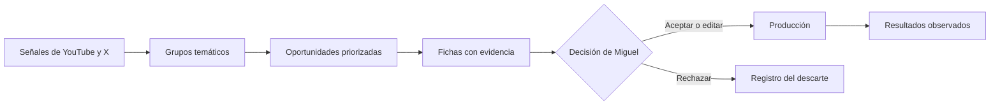
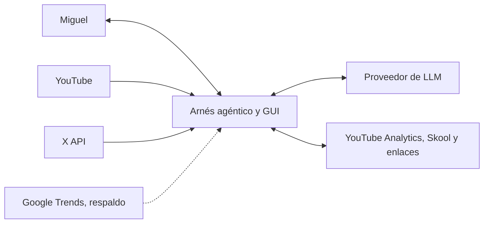

# Tema inicial y plan metodológico

**Curso:** TTMZ0055-493, Proyecto MIA  
**Programa:** Maestría en Inteligencia Artificial Aplicada  
**Autor:** Miguel Ángel Brito Espejo  
**Organización auspiciante:** Bistec LLC  
**Unidad de aplicación:** SingulariDev  
**Número de integrantes:** 1  
**Fecha:** agosto de 2026

Esta actualización incorpora las observaciones emitidas por el Comité el 9 de agosto de 2026, en especial la medición de la línea base, la comparación de agrupamientos, la definición de métricas y la trazabilidad de las decisiones.

## 1. Título aprobado y explicación del proyecto

**Arnés agéntico basado en modelos de lenguaje y análisis semántico de tendencias para priorizar ideas de contenido en YouTube orientadas a la adquisición de miembros para SingulariDev**

SingulariDev será una comunidad en inglés para emprendedores unipersonales interesados en agentes, automatización y productos con inteligencia artificial. YouTube será su primer canal de adquisición. Antes de producir cada video, Miguel debe decidir qué tema merece atención, por qué puede ser útil para esa audiencia y qué evidencia respalda la idea.

Hoy esa decisión exige revisar videos y conversaciones en varias fuentes, comparar temas, investigar y convertir lo encontrado en una ficha de contenido. El proyecto propone un sistema que reúna esas señales, agrupe las que hablan de un mismo asunto, ordene las oportunidades y prepare una ficha con fuentes. La salida no será un video automático. Será un documento que explique la oportunidad, proponga un enfoque y muestre la evidencia utilizada.

Un arnés no crea la fuerza del caballo. La conecta a una tarea y permite dirigirla. Del mismo modo, un modelo de lenguaje puede revisar muchas señales y encontrar relaciones valiosas, pero su desempeño depende del contexto, las herramientas, la información y las instrucciones que recibe. El arnés busca mejorar esas condiciones mediante fuentes autorizadas, memoria, criterios visibles y herramientas de análisis.

La revisión humana no supone que una persona siempre decide mejor. Miguel aporta conocimiento del negocio, asume la responsabilidad editorial y puede intervenir cuando la evidencia es insuficiente. El modelo podrá usar herramientas dentro de límites definidos, pero no publicar contenido ni cambiar permisos por cuenta propia.

| Concepto | Significado dentro del proyecto |
|---|---|
| Señal | Dato que indica actividad alrededor de un tema, como un video reciente o una publicación en X. |
| Grupo temático | Conjunto de señales que tratan un mismo asunto aunque usen palabras distintas. |
| Oportunidad | Grupo que obtiene prioridad por actualidad, crecimiento, afinidad, novedad y factibilidad. |
| Ficha de contenido | Documento con audiencia, necesidad, ángulo, título, estructura, fuentes y limitaciones. |

**Figura 1.** Flujo que se busca apoyar. El prototipo cubrirá desde la recolección de señales hasta la decisión editorial. La producción y sus resultados se observarán como piloto.

## 2. Problema, causas y alcance

### 2.1 Contexto organizacional

Bistec LLC, empresa registrada en Wyoming y representada por Miguel Ángel Brito Espejo, auspicia SingulariDev. El punto de partida es Miguelito Hacks, canal con aproximadamente 7.200 suscriptores al 2 de agosto de 2026. La audiencia histórica es principalmente hispanohablante, mientras la nueva comunidad se dirige a personas angloparlantes. Estas cifras proceden de la propuesta aprobada y deberán respaldarse con una captura fechada de YouTube Analytics.

Miguel investiga temas, selecciona ideas, produce contenido, desarrolla la oferta y administra la comunidad. No existe un equipo editorial que reparta estas tareas. El proyecto se concentra en el trabajo anterior a la producción del video, porque allí hay una carga operativa que puede medirse.

### 2.2 Problema delimitado

> La investigación y priorización manual de ideas para SingulariDev consume una cantidad de tiempo todavía no validada, estimada por el responsable en más de 20 horas semanales, y no deja una trazabilidad completa entre señales, evidencia, criterios y decisiones. Esto reduce el tiempo disponible para producir contenido y dificulta comparar los resultados de las decisiones editoriales.

La cifra de 20 horas es autorreportada. El proyecto la sustituirá por un registro de al menos dos semanas. La falta de miembros o ventas no se define como el problema central, pues esos resultados también dependen del video final, la distribución, la oferta, el precio y la experiencia en Skool.

### 2.3 Cadena causal y FODA resumido

| Condición actual | Efecto inmediato | Consecuencia observable o por medir |
|---|---|---|
| Señales repartidas entre fuentes | Comparación e investigación repetidas | Mayor tiempo por ficha, pendiente de medir |
| Criterios no versionados | Difícil reconstruir una decisión | Baja trazabilidad entre señal, ficha y resultado |
| Operación a cargo de una persona | La investigación compite con producción y comunidad | Menos tiempo disponible para publicar y conversar con usuarios |
| Audiencia nueva sin historial propio | No hay base suficiente para modelar conversión | El proyecto debe evaluar el proceso editorial, no predecir ventas |

El FODA aprobado por el Comité confirma la viabilidad y los límites. Las fortalezas son el acceso al canal, las métricas y la experiencia técnica del autor. Las oportunidades son las APIs oficiales y los modelos con herramientas. Las debilidades son la operación individual y la falta de línea base. Las amenazas incluyen cambios de APIs, variación de tendencias, sesgos, información falsa e instrucciones maliciosas dentro de datos externos.

### 2.4 Alcance

El prototipo podrá:

1. Consultar YouTube y X mediante APIs oficiales.
2. Conservar procedencia, fecha y datos permitidos de cada señal.
3. Comparar BERTopic y K-means sobre las mismas representaciones de texto.
4. Ordenar oportunidades mediante criterios explícitos y pesos versionados.
5. Integrar pi coding agent con herramientas de SingulariDev y una interfaz gráfica.
6. Generar al menos seis fichas en inglés con evidencia y limitaciones.
7. Registrar aceptación, edición o rechazo de cada ficha.
8. Conservar memoria y procedimientos aprobados.
9. Demostrar una personalización pequeña y reversible de contexto, procedimiento o interfaz.
10. Vincular decisiones con resultados posteriores.

Quedan fuera la publicación autónoma, creación final de videos o imágenes, CRM, facturación, funciones multiusuario, predicción de conversión, abandono y valor de vida del cliente. El agente tampoco podrá cambiar permisos, auditoría o código sin mostrar diferencias, superar pruebas y recibir aprobación humana.

### 2.5 Fuentes, volumen y puerta de factibilidad

| Fuente | Unidad y ventana | Volumen y condición mínima | Uso |
|---|---|---|---|
| YouTube Data API | Video público dentro del corte definido | 10 a 15 consultas y al menos 500 resultados brutos por corte, según la propuesta aprobada | Señales, texto y actualidad |
| X API | Publicación reciente dentro de la ventana oficial de siete días | Volumen observado pendiente. Meta provisional de 500 publicaciones brutas por corte, sujeta a costo y calidad | Conversación temprana y contraste con YouTube |
| YouTube Analytics | Métrica propia por video y periodo | Historial disponible del canal y tres videos del piloto | Línea base y resultados |
| Google Trends | Serie agregada por consulta | Respaldo si X no supera la validación | Contraste temporal, no agrupamiento textual |
| Skool y enlaces | Clic, registro o pago observado | Datos propios agregados o seudonimizados | Resultados descriptivos |

X será la segunda fuente principal y su acceso pagado será cubierto por el autor. La documentación actual ofrece búsqueda reciente y cobro por recurso con límites de gasto (X Corp., s. f.-a, s. f.-b). En la semana 3 se decidirá entre tres escenarios:

- **Normal:** YouTube y X superan acceso, calidad, costo y términos. Este es el cumplimiento esperado.
- **Contingencia:** YouTube aporta el corpus textual y Google Trends el contraste temporal si X no es viable.
- **Degradado:** YouTube opera solo durante pruebas de robustez. Este modo no satisface por sí mismo el entregable normal de datos.

Cada fuente deberá registrar permisos, campos faltantes, duplicados, idioma, costo y restricciones de redistribución. YouTube impone cuotas por método, que se comprobarán antes de fijar el corte final (Google Developers, s. f.).

## 3. Justificación y factibilidad

SingulariDev necesita publicar contenido para darse a conocer, pero su único operador también debe desarrollar la comunidad y la oferta. Medir y reducir el tiempo dedicado a ordenar señales y preparar ideas tiene valor organizacional aunque el piloto no consiga nuevos miembros.

La literatura muestra beneficios y límites. Noy y Zhang (2023) observaron mejoras de productividad en tareas de escritura. Csaszar et al. (2024) estudiaron modelos capaces de generar y evaluar estrategias. Otis et al. (2026), en cambio, no encontraron un efecto promedio concluyente al entregar un asistente basado en GPT-4 a 640 emprendedores. El resultado dependió de las recomendaciones que cada participante decidió aplicar.

Prepublicaciones de 2026 ayudan a precisar por qué importa el contexto. Nguyen et al. (2026) encontraron que respuestas complacientes prestaban más atención a afirmaciones de autoridad. Gupta et al. (2026) mantuvieron fijo el contenido y observaron que un cambio de contexto alteraba el juicio de modelos evaluadores. Sun et al. (2026) proponen evaluar si un modelo sabe cuándo confiar en señales externas, en lugar de pedirle que ignore todo contexto. Estos trabajos no prueban superioridad humana. Respaldan un diseño con evidencia recuperable, herramientas limitadas y revisión responsable.

El aporte técnico consiste en conectar tareas que hoy ocurren por separado. Las arquitecturas agénticas combinan memoria, decisión y herramientas (Sumers et al., 2023; Yao et al., 2023). Pi coding agent aporta sesiones, herramientas extensibles e integración mediante SDK o RPC (Earendil Works, 2026). BERTopic ofrece agrupamiento temático interpretable (Grootendorst, 2022), mientras K-means funcionará como comparación. La GUI permitirá que una persona no técnica revise fuentes, decisiones y cambios propuestos.

La utilidad no se reducirá a precisión o clics. Estudios recientes de recomendaciones con LLM muestran que explicaciones contextualizadas pueden mejorar comprensión e intención, pero no todas las dimensiones de utilidad (Feng et al., 2025). Por eso se medirán tiempo, respaldo, utilidad percibida, trazabilidad y robustez.

El trabajo es factible en catorce semanas porque limita el corpus a dos fuentes principales, seis fichas asistidas, seis fichas manuales y tres videos. El autor cuenta con Claude Max, ChatGPT Pro con Codex y una suscripción individual de Cursor como recursos de desarrollo. Estas suscripciones no se tratarán como créditos generales de API. El gasto previsto para inferencia será de hasta 30 dólares mensuales; X tendrá un límite separado.

## 4. Alternativas y selección

### 4.1 Alternativas

**Alternativa A, agente generalista.** Un solo agente consulta fuentes, interpreta señales y redacta la recomendación. Requiere menos componentes, pero mezcla evidencia, cálculo y generación dentro de respuestas variables.

**Alternativa B, arnés híbrido y modular.** Pi coding agent administra la sesión y llama herramientas autorizadas. Módulos separados consultan fuentes, guardan evidencia, agrupan y puntúan. La GUI presenta el proceso y solicita aprobación. La memoria, los procedimientos y ciertos elementos visuales pueden cambiar mediante propuestas versionadas y reversibles.

**Figura 2. Modelo de contexto Nivel 1.** Muestra al responsable, el sistema y las entidades externas. La lógica interna se definirá en la arquitectura del prototipo.

### 4.2 Matriz de selección

La matriz es una estimación *ex ante* del autor, no un resultado experimental. Adapta características de ISO/IEC 25059:2023. Escala: 1 significa que la alternativa no ofrece un mecanismo claro; 3, que lo cubre parcialmente; 5, que lo cubre de forma explícita y verificable.

| Criterio | Peso | Razón del peso |
|---|---:|---|
| Transparencia y procedencia | 20 % | Responde a la falta de trazabilidad del problema. |
| Corrección y reproducibilidad | 20 % | Permite recalcular y probar cada resultado. |
| Control del usuario | 15 % | Miguel debe aceptar, editar, rechazar o detener. |
| Robustez | 15 % | Las fuentes y los modelos pueden fallar o cambiar. |
| Adaptabilidad | 10 % | Deben poder sustituirse fuentes y proveedores. |
| Intervenibilidad | 10 % | El operador debe bloquear módulos o revertir cambios. |
| Riesgos éticos y sociales | 5 % | El sistema apoya una decisión editorial de riesgo limitado. |
| Mantenimiento e integración | 5 % | Importa, pero no es la necesidad principal. |

| Criterio | Agente generalista | Arnés modular |
|---|---:|---:|
| Transparencia y procedencia | 2 | 5 |
| Corrección y reproducibilidad | 2 | 4 |
| Control del usuario | 3 | 5 |
| Robustez | 2 | 4 |
| Adaptabilidad | 4 | 4 |
| Intervenibilidad | 3 | 5 |
| Riesgos éticos y sociales | 2 | 4 |
| Mantenimiento e integración | 4 | 4 |
| **Total ponderado** | **2,55/5** | **4,45/5** |

Se selecciona la alternativa B porque separa datos, cálculos y generación. Obtiene 5 en transparencia, control e intervención porque conserva fuentes, exige aprobación y permite reversión. No recibe 5 en corrección, robustez o riesgos porque el modelo y las APIs todavía pueden fallar. La alternativa A puntúa mejor en adaptabilidad y mantenimiento que en trazabilidad, pero añadir controles externos la acercaría a la alternativa B. Estas calificaciones deberán revisarse durante las pruebas; la norma orienta los criterios, pero no determina los pesos ni los puntajes.

## 5. Objetivos

### 5.1 Objetivo general

Desarrollar y validar, entre agosto y noviembre de 2026, un prototipo de arnés agéntico que use análisis temporal, agrupamiento semántico y modelos de lenguaje para reducir al menos 40 % el tiempo mediano de preparación de fichas de contenido en inglés para SingulariDev.

### 5.2 Objetivos específicos

1. Caracterizar el proceso manual mediante un registro de al menos dos semanas, seis fichas manuales y pruebas de acceso, para establecer tiempo, flujo y volumen observado.
2. Diseñar el modelo de contexto, la arquitectura, los permisos y los criterios de aceptación del arnés, y documentar la comparación *ex ante* de las dos alternativas técnicas.
3. Implementar un flujo que recolecte evidencia y compare BERTopic y K-means sobre el mismo corpus, representaciones, métricas y parámetros registrados.
4. Integrar pi coding agent con herramientas y una GUI para generar seis fichas en inglés, registrar decisiones y demostrar una personalización reversible.
5. Determinar si el prototipo alcanza 40 % de reducción del tiempo mediano, 90 % de respaldo factual y utilidad media mínima de 4 sobre 5; publicar tres videos y reportar sus resultados sin atribución causal.

## 6. Plan metodológico

### 6.1 Diseño de la comparación

El estudio será un desarrollo tecnológico aplicado con comparación intrausuario. La línea base registrará el trabajo cotidiano durante dos semanas. La prueba controlada usará doce temas organizados en seis pares comparables por recencia, volumen de señales y dominio. Antes de ejecutar cada par, se asignará al azar un tema al proceso manual y otro al proceso asistido. Así se obtendrán seis fichas por condición sin repetir el mismo tema.

Miguel será el operador en ambas condiciones. El tiempo activo empezará al iniciar la búsqueda y terminará al aceptar, editar o rechazar la ficha. Se separarán búsqueda, filtrado, investigación, redacción y revisión. Las interrupciones no contarán como tiempo activo. Se reportarán valores individuales, mediana y rango intercuartílico. El tamaño del piloto no permitirá generalizar causalidad fuera del caso.

Los dos revisores externos se confirmarán en la semana 8 y se calibrarán antes de evaluar. Recibirán las doce fichas sin conocer si fueron creadas manualmente o con el arnés.

### 6.2 Datos, agrupamiento y priorización

Cada señal guardará identificador, fuente, fecha, dirección recuperable, texto permitido y métricas disponibles. Los textos externos se tratarán como datos, nunca como instrucciones para el agente.

BERTopic y K-means recibirán el mismo corpus y las mismas representaciones numéricas. Los rangos de parámetros quedarán registrados antes de ejecutar. La comparación ponderará coherencia humana ciega 40 %, estabilidad entre cinco ejecuciones 25 %, cobertura de elementos agrupados 20 % y silueta 15 %. Un método deberá alcanzar al menos 80 % de cobertura y 3,5 sobre 5 en coherencia para ser elegible. Se conservarán parámetros, semillas y resultados.

El método seleccionado formará grupos. Cada grupo recibirá una puntuación por actualidad, crecimiento, afinidad, novedad y factibilidad. Los pesos se variarán en 10 % y 20 % para comprobar si pequeños cambios alteran las primeras posiciones.

### 6.3 Generación, memoria y control

El modelo recibirá la oportunidad y sus fuentes para redactar una ficha estructurada. Solo podrá usar herramientas declaradas. La GUI mostrará eventos, fuentes y solicitudes de aprobación. Miguel podrá aceptar, editar o rechazar.

Como prueba de personalización, el arnés propondrá un cambio pequeño en contexto, memoria, procedimiento o configuración visual. La propuesta deberá mostrar diferencias y vista previa, superar pruebas y recibir aprobación. El núcleo, los permisos y la auditoría no podrán modificarse por este mecanismo.

Cada ejecución guardará código, configuración, fuentes, parámetros, proveedor, costo, salida y decisión humana. Las memorias y personalizaciones tendrán versión y reversión. El repositorio incluirá instrucciones y datos compartibles.

### 6.4 Métricas

> Reducción de tiempo (%) = ((mediana manual - mediana asistida) / mediana manual) × 100

La meta será al menos 40 %. La cobertura factual contará solo afirmaciones cuyo contenido esté respaldado por una fuente recuperable, no enlaces que apenas mencionen el tema.

> Cobertura factual (%) = (afirmaciones verificables respaldadas / afirmaciones verificables totales) × 100

Dos revisores marcarán de forma independiente las afirmaciones verificables y su respaldo. Resolverán desacuerdos por consenso y conservarán el registro. La meta será al menos 90 %.

La utilidad general tendrá estas anclas:

| Puntuación | Interpretación |
|---:|---|
| 1 | No utilizable. La idea no responde a la audiencia o carece de respaldo. |
| 2 | Requiere cambios mayores antes de considerarse. |
| 3 | Utilizable después de una revisión sustancial. |
| 4 | Útil con cambios menores. |
| 5 | Lista para una decisión editorial. |

La meta de 4 sobre 5 se calculará con el promedio de los dos revisores externos; la valoración de Miguel se informará aparte. También se reportarán acuerdo exacto y alfa ordinal de Krippendorff. La rúbrica incluirá relevancia, respaldo, diferenciación, factibilidad y claridad.

Los tres videos tendrán una ventana común de siete días después de su publicación. Visualizaciones, clics, suscripciones, registros y pagos serán observaciones descriptivas, no prueba causal.

### 6.5 Riesgos principales

| Riesgo | Respuesta prevista |
|---|---|
| X no supera costo, acceso o términos | Activar la contingencia con YouTube y Google Trends; documentar la decisión. |
| Datos incompletos, duplicados o no redistribuibles | Validar campos, conservar permisos y publicar solo muestras permitidas. |
| El modelo inventa, complace o sigue instrucciones externas | Exigir respaldo, separar datos e instrucciones y mantener revisión humana. |
| Resultados variables entre ejecuciones | Guardar modelo, parámetros, semillas y versiones. |
| Personalización rompe la GUI | Probar en versión aislada, mostrar diferencias y permitir reversión. |
| No se consiguen dos revisores | Confirmarlos en semana 8; si falla uno, documentar la limitación y no ocultar el sesgo. |
| El piloto es corto para evaluar ventas | Usar resultados comerciales solo de forma descriptiva. |

El tratamiento de riesgos seguirá el NIST AI RMF (Tabassi, 2023).

## 7. Cronograma, hitos y entregables

Miguel será responsable de desarrollo y documentación. Bistec LLC validará el uso organizacional; los revisores participarán en calibración y evaluación; el tutor revisará el método. Los hitos dependen del anterior, salvo la búsqueda de revisores y la preparación del piloto.

| Sem. | Fechas | Actividad y dependencia | Hito o entregable | Responsable |
|---:|---|---|---|---|
| 1 | 10-16 ago. | Incorporar observaciones y preparar instrumentos | Plan e instrumentos | Miguel |
| 2 | 17-23 ago. | Preparar repositorio y probar credenciales | Registro técnico inicial | Miguel |
| 3 | 24-30 ago. | Iniciar línea base; validar YouTube, X y contingencia | E1a, decisión de fuentes | Miguel |
| 4 | 31 ago.-6 sep. | Completar línea base y volumetría | E1, línea base | Miguel |
| 5 | 7-13 sep. | Diseñar contexto, arquitectura, permisos y datos | E2, arquitectura | Miguel, tutor |
| 6 | 14-20 sep. | Implementar recolección y procedencia | E3, flujo de datos | Miguel |
| 7 | 21-27 sep. | Comparar BERTopic y K-means | E4, informe comparativo | Miguel |
| 8 | 28 sep.-4 oct. | Implementar puntuación; confirmar revisores | E5, ranking y revisores | Miguel |
| 9 | 5-11 oct. | Integrar pi, GUI y calibrar rúbrica; publicar video 1 | Prototipo alfa | Miguel, revisores |
| 10 | 12-18 oct. | Generar fichas, probar personalización; publicar video 2 | E6, prototipo funcional | Miguel |
| 11 | 19-25 oct. | Completar prueba ciega; publicar video 3 | Doce fichas evaluadas | Miguel, revisores |
| 12 | 26 oct.-1 nov. | Cerrar las tres ventanas de siete días y analizar métricas | E7 y E8, evaluación y piloto | Miguel |
| 13 | 2-8 nov. | Corregir fallos, cerrar riesgos y documentar límites | Versión candidata | Miguel, tutor |
| 14 | 9-15 nov. | Consolidar código, datos permitidos e instrucciones | E9, prototipo reproducible | Miguel |

## 8. Referencias

Csaszar, F. A., Ketkar, H., & Kim, H. (2024). Artificial intelligence and strategic decision-making: Evidence from entrepreneurs and investors. *Strategy Science, 9*(4), 322-345. https://doi.org/10.1287/stsc.2024.0190

Earendil Works. (2026). *Pi coding agent* (Version 0.80.7) [Software]. GitHub. https://github.com/earendil-works/pi/releases/tag/v0.80.7

Feng, Y., Feuerriegel, S., & Shrestha, Y. R. (2025). Contextualizing recommendation explanations with LLMs: A user study. *arXiv*. https://doi.org/10.48550/arXiv.2501.12152

Google Developers. (s. f.). *Quota calculator*. YouTube Data API. Recuperado el 2 de agosto de 2026 de https://developers.google.com/youtube/v3/determine_quota_cost

Grootendorst, M. (2022). BERTopic: Neural topic modeling with a class-based TF-IDF procedure. *arXiv*. https://doi.org/10.48550/arXiv.2203.05794

Gupta, M., Nair, I., Wang, L., & Kumar, D. (2026). Context over content: Exposing evaluation faking in automated judges. *arXiv*. https://doi.org/10.48550/arXiv.2604.15224

International Organization for Standardization & International Electrotechnical Commission. (2023). *ISO/IEC 25059:2023 software engineering, systems and software Quality Requirements and Evaluation, quality model for AI systems*. https://www.iso.org/standard/80655.html

Nguyen, H., Kamruzzaman, M., Chhabra, A., & Kim, G. L. (2026). Token-level diagnosis of sycophancy in LLMs with attribution-guided steering. *arXiv*. https://doi.org/10.48550/arXiv.2607.28906

Noy, S., & Zhang, W. (2023). Experimental evidence on the productivity effects of generative artificial intelligence. *Science, 381*(6654), 187-192. https://doi.org/10.1126/science.adh2586

Otis, N. G., Clarke, R., Delecourt, S., Holtz, D., & Koning, R. (2026). *The uneven impact of generative AI on entrepreneurial performance: Evidence from a field experiment in Kenya* (Working Paper 24-042). Harvard Business School. https://www.hbs.edu/ris/download.aspx?name=24-042.pdf

Sumers, T. R., Yao, S., Narasimhan, K., & Griffiths, T. L. (2023). Cognitive architectures for language agents. *arXiv*. https://doi.org/10.48550/arXiv.2309.02427

Sun, X., Chow, W., Wang, Y., Liu, J., Gao, W., Wu, Q., & Kong, L. (2026). Learning when to trust via selective context preference optimization. *arXiv*. https://doi.org/10.48550/arXiv.2608.06377

Tabassi, E. (2023). *Artificial Intelligence Risk Management Framework (AI RMF 1.0)* (NIST AI 100-1). National Institute of Standards and Technology. https://doi.org/10.6028/NIST.AI.100-1

X Corp. (s. f.-a). *Search Posts: Recent*. Recuperado el 25 de agosto de 2026 de https://docs.x.com/x-api/posts/search-recent-posts

X Corp. (s. f.-b). *X API pay-per-usage pricing and credits*. Recuperado el 25 de agosto de 2026 de https://docs.x.com/x-api/getting-started/pricing

Yao, S., Zhao, J., Yu, D., Du, N., Shafran, I., Narasimhan, K., & Cao, Y. (2023). ReAct: Synergizing reasoning and acting in language models. In *International Conference on Learning Representations*. https://openreview.net/forum?id=WE_vluYUL-X
