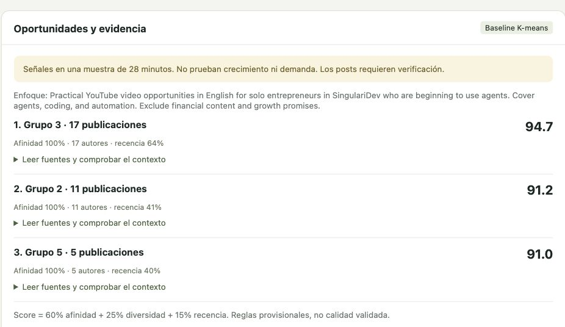
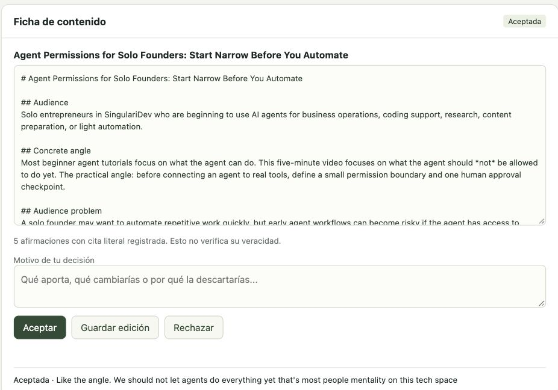

# Tarea 5. Informe de resultados preliminares

Miguel Ángel Brito Espejo · Proyecto MIA · Group 5  
Bistec LLC · Unidad de aplicación: SingulariDev  
29 de septiembre de 2026 · Ecuador

## 1. Prototipo, método de referencia y datos utilizados

El prototipo ayuda a investigar y priorizar ideas de videos en inglés para atraer miembros a SingulariDev. El proceso manual actual no conserva un registro completo de las fuentes y los motivos de cada decisión. Su carga estimada de más de veinte horas semanales aún requiere medición. En esta entrega, el operador conversa con el sistema, revisa ideas sustentadas en publicaciones de X y recibe una ficha con título, audiencia, estructura y fuentes. Después puede aceptarla, editarla o rechazarla.

La interfaz web funciona en el equipo del operador y utiliza Pi 0.99.1 para gestionar la conversación. El modelo gpt-5.5 interpreta la petición y redacta; herramientas específicas consultan las publicaciones guardadas, calculan puntuaciones y conservan borradores. La decisión final corresponde al operador. El sistema registra motivo, fecha y versión de la ficha, y recupera ese trabajo al reiniciar. No publica contenidos automáticamente.

El método inicial de referencia, llamado baseline, es el definido en la Tarea 3. Qwen3-Embedding-0.6B convierte cada texto en 1.024 valores numéricos que representan su contenido. Estas representaciones se llaman embeddings. UMAP las reduce a cinco valores y K-means forma diez grupos por similitud. Se hicieron cinco ejecuciones con distintos estados iniciales, identificados por las semillas 42 a 46; la primera es la referencia. Qwen ya estaba entrenado y no se modificó. El análisis se ejecutó en CPU local, con macOS arm64 y Python 3.12.12.

Una solicitud a la API oficial de X recuperó 100 publicaciones en inglés sobre agentes, Claude Code y Cursor AI. Se excluyeron retuits, respuestas y términos relacionados con criptomonedas. Tras validar los campos y eliminar un duplicado, quedaron 99 textos de 94 autores, con un máximo permitido de 4.000 caracteres. Cubren apenas 28 min 37 s, insuficientes para medir cambios en las tendencias. Se ordenaron por fecha: 59 textos permitieron ajustar los grupos, 20 sirvieron para validar su comportamiento y 20 quedaron reservados para una prueba posterior. Estos últimos no se procesaron ni se usaron en la conversación.

## 2. Resultados del método de referencia

La silueta mide si cada texto se parece más a su propio grupo que a otros. Va de -1 a 1; los valores negativos indican asignaciones poco separadas. Se calculó con distancia coseno sobre las representaciones originales. El índice ARI mide el acuerdo entre ejecuciones: cerca de 1 indica agrupaciones similares. Se promediaron las diez comparaciones entre las cinco ejecuciones. No se midió exactitud por categorías porque aún no hay etiquetas revisadas por personas.

| Indicador | Entrenamiento | Validación |
|---|---:|---:|
| Registros | 59 | 20 |
| Silueta, ejecución de referencia | 0,1503 | -0,0388 |
| Silueta media de cinco ejecuciones | 0,1257 | -0,0182 |
| Textos asignados a algún grupo | 100 % | 100 % |
| Grupos con textos / grupos de un solo texto | 10 / 0 | 7 / 5 |
| Acuerdo medio entre ejecuciones, ARI | 0,8060 | 0,9028 |

Convertir los 79 textos de desarrollo en representaciones numéricas tardó 15,38 s, incluida la carga del modelo. Las cinco ejecuciones de agrupamiento sumaron 9,04 s. Son tiempos de cómputo, no de trabajo humano. El lote de X costó como máximo USD 0,50 estimados; junto con una prueba previa de diez publicaciones, hasta USD 0,55. La factura exacta no se verificó. La evaluación conversacional reutilizó los datos sin nuevas solicitudes a X.

<!-- pagebreak -->

## 3. Resultados del prototipo conversacional

Las ideas se ordenan con una puntuación provisional: 60 % coincidencia de palabras con el tema solicitado, 25 % diversidad de autores y 15 % cercanía a la fecha más reciente del lote. Cada opción necesita publicaciones de al menos dos autores. El filtro editorial descartó 16 de 79 textos sin cambiar el análisis anterior. Las tres opciones surgieron de los grupos 3, 2 y 5, con 94,67; 91,15 y 90,97 puntos. Estos valores no miden calidad ni crecimiento.

Tras corregir el filtro inicial, pasaron diez comprobaciones del código y seis del servicio web y la conversación. Con Pi, proponer tres ideas tardó 22,48 s; guardar una ficha, 24,08 s; cambiar de tema, 16,14 s; y detectar falta de evidencia sobre riego de cacao en Ecuador, 6,39 s. Las acciones automatizadas de aceptar, editar y rechazar se identificaron como pruebas. Un reinicio recuperó ocho mensajes y tres decisiones de prueba.

Miguel aceptó a las 21:16 la ficha "Agent Permissions for Solo Founders" por su enfoque sobre limitar las acciones de los agentes. Las cinco afirmaciones registradas incluyen citas que coinciden con los textos originales. Ese control identifica la fuente, pero no confirma su veracidad ni que respalde toda la afirmación. No se midieron utilidad ni ahorro de tiempo.

<!-- pagebreak -->

## 4. Análisis crítico

El prototipo permite conversar sobre una necesidad editorial, revisar fuentes, comparar ideas y guardar una ficha con su decisión. Así aporta un registro que falta en el proceso manual. Todavía no se ha comprobado la reducción prevista del 40 % en tiempo mediano, una utilidad media de 4 sobre 5 ni el respaldo del 90 % de las afirmaciones verificables. Para medirlos se compararán seis fichas elaboradas con el sistema y seis manualmente, con evaluación de Miguel y dos revisores externos.

Los grupos tienen separación débil: la silueta de validación fue negativa en las cinco ejecuciones. En la referencia, quince de veinte textos se concentran en dos grupos y los otros cinco quedan solos. K-means asigna todos los textos a un grupo, aunque encajen mal. Por eso, asignar el 100 % y obtener resultados similares entre ejecuciones no demuestra utilidad. Persisten publicidad financiera, temas mezclados y textos casi idénticos con menciones o enlaces distintos. La muestra pequeña limita las conclusiones sobre la causa de estos errores.

En la primera conversación, el sistema no propuso ideas aunque había textos pertinentes. Buscó frases completas que incluían requisitos de audiencia y no encontró coincidencias. Se ajustaron sus instrucciones para buscar palabras del tema; una petición posterior sí produjo tres opciones. El error observado se corrigió, pero falta probar otros casos. Buscar palabras exactas puede omitir sinónimos; los porcentajes de puntuación son provisionales y distintos autores pueden repetir la misma fuente. Además, una cita literal no confirma una noticia ni la interpretación del modelo.

## 5. Próximos pasos por prioridad

P0 corresponde al trabajo inmediato; P1, a las mejoras siguientes; y P2, al piloto posterior.

| Prioridad | Próximo trabajo | Criterio de cierre |
|---|---|---|
| P0 | Revisar textos irrelevantes, casi duplicados o incompletos y las cinco afirmaciones de la ficha. | Contar los casos y comprobar que las fuentes respalden las afirmaciones. |
| P0 | Medir tiempo manual y utilidad de las fichas. | Registrar dos semanas; comparar seis fichas manuales y seis asistidas con una escala de utilidad definida. |
| P1 | Probar cinco y quince grupos, y el método alternativo BERTopic, sobre los mismos textos. | Comparar separación, acuerdo y claridad. Mantener reservados los datos de prueba final. |
| P1 | Revisar los porcentajes de puntuación y las palabras de búsqueda. | Comprobar cómo cambia el orden de las ideas y probar sinónimos, cambios de tema y falta de evidencia. |
| P1 | Recoger datos de más periodos y una segunda fuente. | Definir presupuesto, permisos, conservación, borrado y envío de los datos a proveedores. |
| P2 | Preparar tres videos del piloto tras revisar las fichas. | Registrar aprobaciones y resultados comerciales sin afirmar que el sistema los causó. |

## 6. Evidencias y cómo repetir el ensayo

El repositorio `proyecto/prototipo-tarea-05/` contiene el código, instrucciones de uso, bitácora y versiones de los programas necesarios. `resultados.json` y `evaluacion-prototipo.json` guardan configuración, tiempos y huellas de los archivos para identificar cambios. `node app.mjs` inicia el prototipo; `node test-editorial.mjs` repite las comprobaciones locales y la opción `--live` añade conversaciones con Pi. Las capturas muestran el sistema funcionando.

Las credenciales, publicaciones e historiales no se incluyen en Git. La conversión de textos en valores numéricos ocurre localmente; la conversación envía publicaciones al proveedor del modelo mediante la cuenta instalada en Pi. Sus costos estimados no son cobros adicionales comprobados. Antes de ampliar el uso, falta definir cómo conservar y borrar originales y copias. El acceso a X no autoriza por sí solo a redistribuir los textos. El registro conserva también el error inicial.

Referencias técnicas: [Qwen3-Embedding-0.6B](https://huggingface.co/Qwen/Qwen3-Embedding-0.6B); [silueta](https://scikit-learn.org/stable/modules/generated/sklearn.metrics.silhouette_score.html); [ARI](https://scikit-learn.org/stable/modules/generated/sklearn.metrics.adjusted_rand_score.html). Versiones y configuración completas en el README y los registros experimentales.
