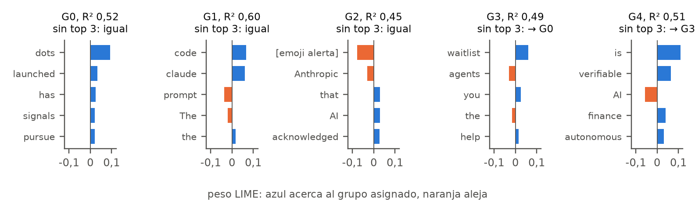

# Interpretabilidad y ética del prototipo

Miguel Ángel Brito Espejo · Grupo 5 · Maestría en Inteligencia Artificial
Bistec LLC · SingulariDev · Tarea 7
13 de octubre de 2026 · Análisis exploratorio sobre datos de desarrollo

> **Resumen en 30 segundos**
> - **El ranking no mide relevancia.** En el caso real, el orden de las ideas lo decidieron segundos de diferencia en la hora de publicación.
> - **Los grupos mezclan tema y formato.** Un filtro manual anti-cripto y la presencia de enlaces pesan más que muchas palabras del tema.
> - **Riesgo principal.** Una puntuación de 95 sobre 100 inspira una confianza que no merece.
> - **Ajuste prioritario.** Medir la afinidad por significado, sin el término de búsqueda, y retirar la recencia hasta tener varios días de datos.

## 1. Modelo evaluado

**Objetivo.** El prototipo me ayuda, como operador editorial de SingulariDev, a elegir qué videos en inglés preparar para emprendedores que empiezan con agentes de IA. Agrupa publicaciones de X por tema y ordena los grupos; un asistente redacta la ficha y yo decido. Analicé las dos piezas que deciden qué veo primero.

| Pieza | Cómo funciona | Qué decide |
|---|---|---|
| Agrupamiento K-means, 5 grupos | Qwen3-Embedding convierte cada publicación en un vector, UMAP lo resume y K-means forma cinco grupos | Qué temas existen |
| Ranking editorial | Puntúa cada grupo de 0 a 100. Afinidad con el enfoque 60 %, diversidad de autores 25 % y recencia 15 % | Qué tema aparece primero |

**Datos.** 79 publicaciones de desarrollo de 74 autores, tomadas de X en 25 minutos, solo en inglés. El análisis reproduce exactamente los grupos y puntuaciones guardados (94,67, 91,15 y 90,97), así que explica el modelo real.

## 2. Análisis de interpretabilidad

| Pregunta | Técnica | Confiabilidad |
|---|---|---|
| ¿Qué separa los grupos en general? | SHAP sobre un modelo sustituto, una regresión logística con 103 palabras y 6 rasgos de formato | Aproximada. Imita el agrupamiento en 62 % de los casos; el azar daría 25 % |
| ¿Por qué un texto cae en su grupo? | LIME sobre el pipeline real, con 500 variaciones del texto | Moderada. Ajuste local R² de 0,45 a 0,60 |
| ¿Por qué un grupo queda primero? | Valores de Shapley exactos | Exacta, porque la fórmula es lineal |

**Patrones observados.**

- Tres grupos tienen un tema claro. G0 reúne noticias de Dots, de OpenAI; G1, conversaciones sobre Claude Code; G4, finanzas y ejecución verificable.
- G3 funciona como cajón de sastre. Su rasgo más fuerte apenas pesa 0,07.
- Las asignaciones son frágiles. Dos de cinco textos cambian de grupo al borrar tres palabras, y en G4 la palabra decisiva es "is".

**Coherencia con el problema.** Parcial. Los temas claros, como Claude Code, sí interesan a la audiencia de SingulariDev. Pero el modelo también agrupa por estilo y el ranking no refleja valor editorial.

## 3. Riesgos éticos

Base: principios del curso de transparencia y rendición de cuentas (IEEE, 2022), equidad (UNESCO, 2023) y privacidad (Corrêa et al., 2023).

| Riesgo | Evidencia | Impacto posible | Principio |
|---|---|---|---|
| Falsa precisión | 95 sobre 100 decidido por segundos | Elijo un tema por la hora de publicación creyendo que es el mejor | Transparencia |
| Sesgo circular | "agent", el término de búsqueda, aparece en 83 % de los textos | El sistema confirma lo que ya buscaba y oculta temas vecinos | Rendición de cuentas |
| Exclusión silenciosa | El filtro elimina 12 de 17 textos de G4, incluido "ransomware" | Desaparece un tema de seguridad útil para la audiencia, sin aviso | Transparencia |
| Proxies de formato | El formato explica 19 % de la importancia | Pesan más las cuentas de noticias y promoción; otros estilos y otros idiomas quedan fuera | Equidad |
| Agenda de proveedores | "claude", "openai" y "dots" definen grupos | Videos que amplifican anuncios comerciales sin verificar | Responsabilidad |
| Uso indebido | Muestra de 25 minutos | Tomar el ranking como predicción de tendencias o ventas | Uso apropiado |
| Privacidad | Textos de terceros enviados al LLM | Exposición de autores que no consintieron este uso | Privacidad |

## 4. Hallazgos clave

| Variable | Dirección y magnitud | Qué significa |
|---|---|---|
| Recencia, peso 15 % | Decide el orden. G0 gana por 290 s de diferencia media; los puestos 2 a 4 se separan por 81 y 74 s, menos de 1 punto | El primer lugar es el grupo más fresco, no el más relevante |
| Afinidad, peso 60 % | Saturada: vale 1 en los cuatro primeros. Sin "agent", los tres primeros pasan a ser G1, G3 y G0 | Mide el término de búsqueda, no el enfoque |
| Diversidad, peso 25 % | Aporte nulo, Shapley 0. Todos los grupos superan el tope de cinco autores | Un cuarto de la fórmula no aporta información |
| Filtro financiero | Rasgo más fuerte del agrupamiento, 0,26; define G4 | Una regla manual da forma a los temas |
| Formato: enlace, hashtags, menciones, emoji y longitud | 19 % de la importancia. Un emoji de alerta aleja un texto de G2 | Los grupos mezclan tema y estilo |
| Palabras de tema: "code", "claude", "openai" | Empujan con fuerza hacia G1 y G0 | Aquí el modelo sí capta temas útiles |

También probé 171 combinaciones de pesos y G0 ganó en todas. Eso no demuestra robustez. Pasa porque dos de los tres criterios no varían entre grupos.

## 5. Estrategias de mitigación

- **Ajustes técnicos.** Mostrar en la interfaz el desglose de cada puntuación y declarar empate si la diferencia es menor de 3 puntos.
- **Datos y variables.** Registrar el término de búsqueda y avisar cuando un término del enfoque aparezca en más de la mitad de los textos. Mostrar cuántos textos excluye el filtro en cada grupo.
- **Uso responsable.** Exigir una fuente primaria antes de aceptar una ficha sobre un producto. Presentar el ranking como apoyo de lectura, no como predicción. Mantener la aprobación humana y los datos de autores en local.
- **Límites explícitos.** 25 minutos de datos, solo inglés y 74 autores. SHAP aproximado al 62 % y LIME con R² de 0,60 como máximo. El sistema no mide crecimiento, novedad ni conversión.

## 6. Aprendizajes derivados del análisis

| Supuesto inicial | Qué mostró el análisis | Veredicto |
|---|---|---|
| Los grupos son temas | Tres temas claros, un cajón de sastre y peso del formato | Confirmado a medias |
| La puntuación mide relevancia | Mide frescura y repite el término de búsqueda | Refutado |
| Ajustar los pesos mejora el ranking, como pidió el Comité | Los pesos casi no importan si los criterios están saturados | Cuestionado. Hay que cambiar las señales, no los pesos |

**Qué cambia en la práctica.** El valor del sistema está en organizar fuentes y acelerar la redacción, no en decidir qué tema importa. Esa decisión sigue siendo mía, y el sistema debe mostrar por qué ordena como ordena. También aprendí a no fiarme de una sola técnica. SHAP por sí solo habría ocultado la fragilidad que LIME reveló.

## 7. Propuestas de ajuste al modelo

| Evidencia | Ajuste | Cómo sabré que funcionó |
|---|---|---|
| "agent" cubre 83 % y satura la afinidad | Quitar los términos de búsqueda y medir afinidad por similitud semántica con el enfoque | Ningún término supera 50 % y el orden cambia con enfoques distintos |
| Diversidad con Shapley 0 | Contar autores distintos por publicación, sin tope de cinco | El criterio varía entre grupos |
| Recencia decide por 74 a 290 s | Retirarla hasta tener siete días de datos y medir crecimiento entre ventanas | Empates declarados y diferencias con intervalo |
| El formato pesa 19 % | Quitar enlaces, menciones, emoji y hashtags antes del embedding | Menos peso SHAP del formato, con silueta y ARI en un corte nuevo |
| El filtro elimina 71 % de G4 | Convertir la exclusión en etiqueta visible y sacar "ransomware" de la lista | Exclusiones visibles por grupo |
| G3 difuso y textos que cambian de grupo | Mostrar la probabilidad de asignación y marcar las menores de 0,4 | Prueba de borrado repetida en cada versión |

Referencias: Corrêa, N. K., et al. (2023). Worldwide AI ethics. Patterns, 4(10), 100857. IEEE (2022). Ethically Aligned Design, 2.ª ed. UNESCO (2023). Ethics of Artificial Intelligence in Education. Lundberg y Lee (2017), SHAP. Ribeiro et al. (2016), LIME. Código y resultados: interpretabilidad.py e interpretabilidad-tarea7.json en el repositorio del prototipo.
