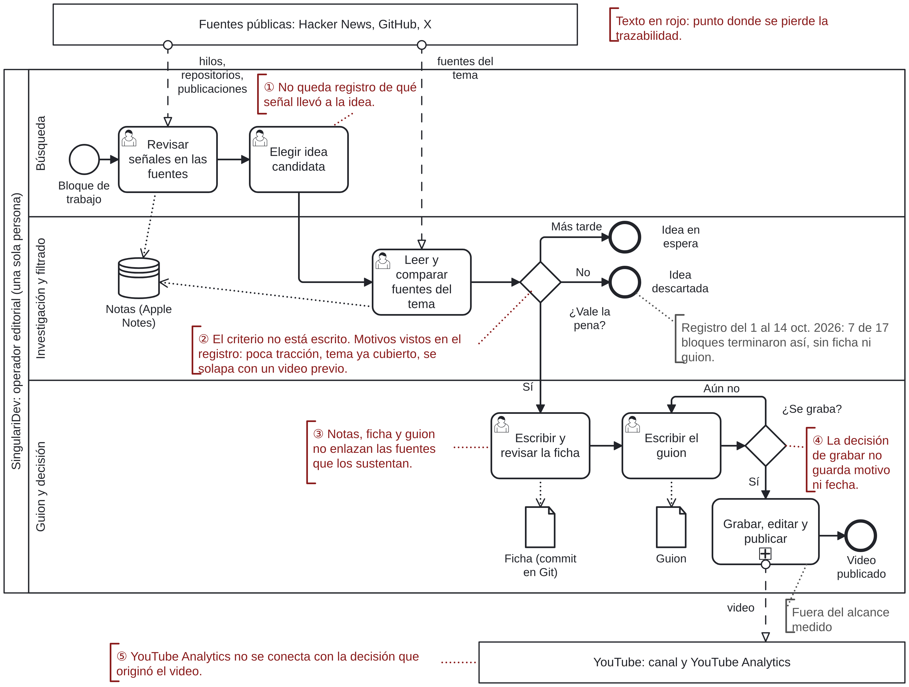
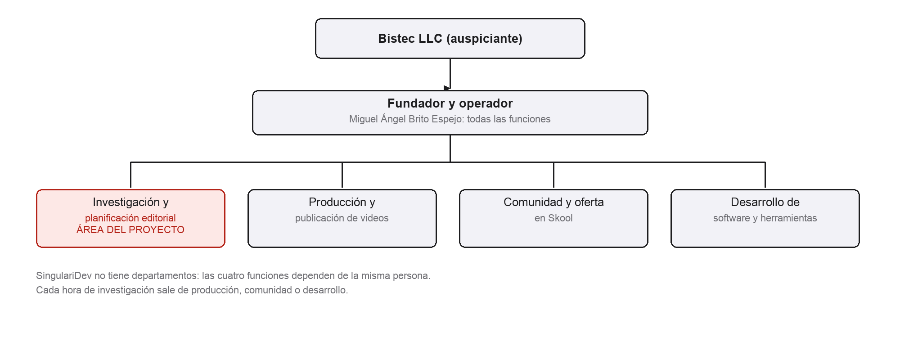
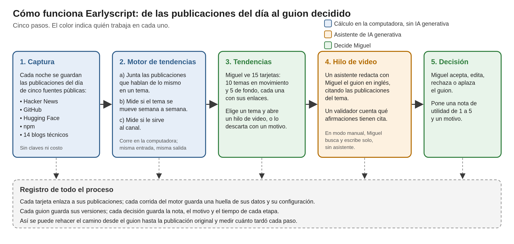
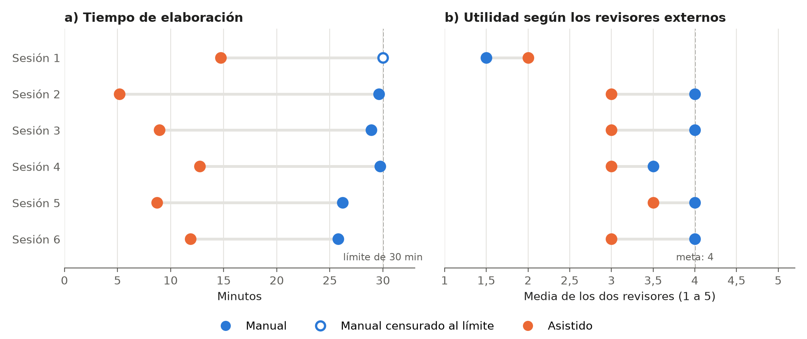

# Resumen

SingulariDev, unidad de Bistec LLC, enseña inteligencia artificial aplicada en YouTube. Su fundador prepara cada idea de video a mano. Medimos ese trabajo durante dos semanas: solo buscar y escribir ocupó 14,2 horas en una semana reconstruida y 16,1 en otra cronometrada, sin registro de las decisiones. Construimos Earlyscript, una aplicación de escritorio en la que la persona conserva la decisión final. Su motor revisa cada día cinco fuentes públicas, como Hacker News y GitHub. Agrupa las publicaciones con un modelo de embeddings local y entrega tarjetas con el crecimiento de cada tema, su afinidad con el canal y la evidencia enlazada. Un asistente ayuda a escribir el guion, un validador cuenta sus citas y la aplicación registra cada decisión, su motivo y el tiempo de cada etapa. Elegimos este arnés modular frente a un agente generalista con una matriz basada en ISO/IEC 25059:2023 (4,45 frente a 2,55 sobre 5). Evaluamos la herramienta con seis pares de temas sorteados: uno se trabajó a mano y el otro con asistencia. El modo asistido fue más rápido en los seis pares. El tiempo mediano bajó de 29,26 a 10,41 minutos, un 64,4 % menos, frente a una meta del 40 % (Wilcoxon exacta, p 0,031). Los guiones asistidos citaron el 94 % de sus afirmaciones, frente al 47 % de los manuales, y cada uno guarda sus fuentes, sus versiones y la decisión que lo aprobó. Todo funcionó con menos de 1 USD en pagos por uso. Dos revisores externos ciegos dieron 2,92 sobre 5 a los asistidos y 3,50 a los manuales, con una meta de 4, y el 83 % de las citas asistidas revisadas quedó respaldado, con una meta del 90 %. Nuestra hipótesis es que la diferencia viene del estilo genérico del modelo que redacta, y el trabajo futuro propone instrucciones de estilo para corregirlo. En 14 semanas, una persona con asistentes de IA construyó y evaluó una herramienta que reduce a poco más de un tercio el tiempo de escribir un guion y deja rastro de cada decisión.

**Palabras clave:** arnés agéntico, detección de tendencias, modelos de lenguaje, priorización editorial, evaluación ciega.

# Abstract

SingulariDev, a unit of Bistec LLC, teaches applied artificial intelligence on YouTube. Its founder prepares each video idea by hand. We measured that work for two weeks: searching and writing alone took 14.2 hours in one reconstructed week and 16.1 in another timed week, with no record of the decisions. We built Earlyscript, a desktop application in which the person keeps the final decision. Its engine checks five public sources every day, such as Hacker News and GitHub. It clusters the posts with a local embedding model and delivers cards with each topic's growth, its affinity with the channel, and linked evidence. An assistant helps write the script, a validator counts its citations, and the application records each decision, its reason, and the time of each stage. We chose this modular harness over a generalist agent with a matrix based on ISO/IEC 25059:2023 (4.45 versus 2.55 out of 5). We evaluated the tool with six randomly drawn pairs of topics: one was worked by hand and the other with assistance. The assisted mode was faster in all six pairs. The median time fell from 29.26 to 10.41 minutes, 64.4 % less, against a target of 40 % (exact Wilcoxon test, p 0.031). The assisted scripts cited 94 % of their claims, versus 47 % for the manual ones, and each one keeps its sources, its versions, and the decision that approved it. Everything ran on less than 1 USD in pay-per-use charges. Two blinded external reviewers gave 2.92 out of 5 to the assisted scripts and 3.50 to the manual ones, against a target of 4, and 83 % of the reviewed assisted citations were supported, against a target of 90 %. Our hypothesis is that the gap comes from the generic style of the model that writes, and future work proposes style instructions to correct it. In 14 weeks, one person with AI assistants built and evaluated a tool that cuts the time to write a script to just over a third and leaves a trace of every decision.

**Keywords:** agentic harness, trend detection, language models, editorial prioritization, blind evaluation.

# Introducción

## Identificación y descripción del problema o necesidad

SingulariDev es una comunidad en línea que enseña inteligencia artificial aplicada. Publica videos en YouTube y desde ahí invita a su audiencia a una comunidad de pago. La lleva una sola persona: su fundador.

Cada video empieza mucho antes de grabar. El fundador revisa Hacker News, GitHub y X en busca de temas. Intuye cuáles van a crecer. Elige uno, lee sus fuentes, las compara y escribe un guion. Al final decide si lo graba. Todo a mano y sin ayuda.

Para saber cuánto cuesta ese trabajo, lo medimos durante dos semanas de octubre de 2026. El fundador anotó cada sesión y separó el tiempo de buscar del tiempo de escribir (Tabla 1).

**Tabla 1**

*Carga del proceso manual en dos semanas de octubre de 2026*

| | Semana 1 | Semana 2 |
|---|---:|---:|
| Horas de búsqueda y escritura | 14,2 | 16,1 |
| Sesiones de trabajo | 8 | 9 |
| Sesiones que terminaron sin nada escrito | 3 | 4 |

*Nota.* Elaboración propia. La semana 1 se reconstruyó con el historial del navegador y las notas. La semana 2 se cronometró. No incluye grabación ni edición. Medianas por sesión: 62,5 minutos de búsqueda y 105 de escritura.

El registro deja tres lecciones:

- Buscar y escribir ocupó 14,2 horas en la semana reconstruida y 16,1 en la cronometrada, antes de grabar un solo minuto.
- Cada sesión se lleva cerca de una hora de búsqueda. Cuando hay algo que escribir, suma casi dos más.
- Siete de las 17 sesiones terminaron sin nada escrito. En ellas se fue la mitad de todo el tiempo de búsqueda.

La Figura 1 dibuja el proceso completo en notación Business Process Model and Notation (BPMN) 2.0. Los números en rojo marcan cinco puntos donde el proceso olvida algo: qué señal originó la idea, con qué criterio se eligió, qué fuentes sostienen el guion, por qué se grabó y qué pasó después con el video.

**Figura 1**

*Proceso manual actual de búsqueda, priorización y guion, en notación BPMN 2.0*

*Nota.* Elaboración propia a partir del registro de carga y de la propuesta (Brito Espejo, 2026), validada por el operador. BPMN es una notación estándar para dibujar procesos. Una sola persona cumple los tres carriles. En rojo, los puntos donde se pierde el rastro. Grabación, edición y publicación quedan fuera de lo medido.

La decisión de seguir con una idea llega después de buscar y leer. Por eso una idea descartada ya gastó su tiempo de búsqueda. Las ideas que siguen producen una ficha y un guion, pero ninguno enlaza sus fuentes ni el criterio que las dejó pasar. La decisión de grabar no guarda motivo ni fecha, y YouTube Analytics no la conecta con el video. Quedan productos sueltos, no el camino de la señal a la decisión.

El problema tiene entonces dos caras. El proceso es lento. Y no deja rastro: cuando un video funciona o fracasa, no hay forma de volver atrás y ver qué decisión lo produjo. Este proyecto construye una herramienta que ataca las dos, sin quitarle la última palabra a la persona.

Detrás de esas dos caras vemos cuatro causas probables:

- Las señales están repartidas entre muchas fuentes.
- Los criterios editoriales no están escritos.
- Una sola persona investiga y produce.
- Las fuentes cambian sus cuotas y sus términos.

La falta de miembros en la comunidad no es el problema que atacamos, porque también depende del video, la oferta y el precio. Lo que hay es una necesidad de la organización, no la falla de un sistema. Por eso la analizamos con una matriz de fortalezas, oportunidades, debilidades y amenazas (FODA), que el Comité aceptó (*Reporte ejecutivo de evaluación de proyecto*, 2026).

**Tabla 2**

*FODA de SingulariDev*

| | Interno | Externo |
|---|---|---|
| **Favorable** | Canal propio con unos 7.200 suscriptores al 2 de agosto de 2026 y acceso a sus métricas. Experiencia del fundador en software, inteligencia artificial (IA) y contenido. | Interfaces de programación de aplicaciones (APIs) y datos públicos con historial. Un segmento angloparlante nuevo de emprendedores unipersonales. Modelos de lenguaje con herramientas para sintetizar evidencia. |
| **Desfavorable** | Operación individual con 14,2 y 16,1 horas semanales medidas de búsqueda y escritura. Audiencia histórica en español y comunidad inglesa sin historial. Criterios manuales sin registro. | Cambios de cuotas, precios y términos de las fuentes. Sesgo, saturación y variación rápida de los temas. Alucinación del modelo y dependencia del proveedor. |

*Nota.* Adaptado de Brito Espejo (2026, sección 2.3). La carga semanal viene de la Tabla 1. La cifra de suscriptores viene de la propuesta y no tiene captura fechada de YouTube Analytics.

Un modelo de lenguaje por sí solo no resuelve esta necesidad. La asistencia generativa redujo un 40 % el tiempo de escritura profesional (Noy y Zhang, 2023). Pero preparar una idea también exige buscar y elegir. En un estudio con 640 emprendedores, la IA generativa no tuvo un efecto promedio concluyente (Otis et al., 2026). Además, una conversación con un modelo no registra fuentes, criterios ni decisiones.

De ahí salen seis requerimientos para la herramienta:

- Cada decisión humana queda registrada con motivo y fecha.
- Cada afirmación se puede rastrear hasta su fuente.
- Los guiones se escriben en inglés.
- Solo se usan datos autorizados.
- La inferencia no pasa de 30 USD al mes.
- El tiempo y la calidad se miden frente al proceso manual.

## Descripción de la organización

Bistec LLC auspicia el proyecto (Anexo 1). Es una sociedad de responsabilidad limitada de Wyoming, Estados Unidos, del sector de software y productos digitales. SingulariDev es su unidad de formación y comunidad en línea sobre IA aplicada. Su fundador, Miguel Ángel Brito Espejo, representa a ambas.

- **Servicios:** contenido formativo en YouTube y una comunidad de pago en Skool.
- **Segmento:** emprendedores unipersonales angloparlantes interesados en agentes de IA.
- **Misión y visión:** no hay declaraciones formales. Su propósito es atraer a ese segmento desde YouTube hacia la comunidad en Skool.

Una persona cumple cuatro funciones (Figura 2). La necesidad está en una de ellas: la investigación y planificación editorial.

El canal Miguelito Hacks tiene una audiencia mayoritariamente hispanohablante. Los tres videos del piloto en inglés están en producción y ninguno está publicado. La comunidad en Skool aún no tiene historial. Por eso validamos la herramienta con contenido en inglés para programadores. El producto usa un solo código para la tesis y para su uso posterior, con Bistec LLC como titular. Su modelo de negocio queda fuera del proyecto.

**Figura 2**

*Organigrama funcional de SingulariDev*

# Análisis de posibles soluciones

## Identificación y selección de la mejor solución

Había dos maneras de usar modelos de lenguaje en este problema. Difieren en quién calcula la prioridad de un tema y en cuánto control conserva el operador.

En la **alternativa A, agente generalista**, un agente con herramientas consulta las fuentes, interpreta las señales y redacta. Se construye rápido, pero prioriza sin mostrar cómo y puede ordenar distinto en cada ejecución.

La **alternativa B, arnés híbrido y modular**, separa la captura de datos, el almacén de evidencia, un análisis determinista y la redacción. Determinista quiere decir que los mismos datos y pesos dan siempre el mismo orden. El operador acepta, edita o rechaza cada pieza.

Las comparamos con la norma ISO/IEC 25059:2023, de la Organización Internacional de Normalización (ISO) y la Comisión Electrotécnica Internacional (IEC). Esta norma adapta a los sistemas de IA el modelo de calidad de ISO/IEC 25010 y añade características propias, como la controlabilidad, la intervenibilidad y la transparencia (International Organization for Standardization [ISO] e International Electrotechnical Commission [IEC], 2023a, 2023b). Tomamos ocho características, les dimos un peso y puntuamos cada alternativa de 1 (sin mecanismo claro) a 5 (cobertura explícita y verificable).

**Tabla 3**

*Matriz de selección*

| Criterio ISO/IEC 25059 | Peso | A | B |
|---|---:|---:|---:|
| Transparencia y procedencia | 20 % | 2 | 5 |
| Corrección funcional y reproducibilidad | 20 % | 2 | 4 |
| Controlabilidad del usuario | 15 % | 3 | 5 |
| Robustez ante fallos | 15 % | 2 | 4 |
| Adaptabilidad funcional | 10 % | 4 | 4 |
| Intervenibilidad | 10 % | 3 | 5 |
| Riesgos sociales y éticos | 5 % | 2 | 4 |
| Mantenibilidad e integración | 5 % | 4 | 4 |
| **Total ponderado** | **100 %** | **2,55** | **4,45** |

*Nota.* Adaptado de Brito Espejo (2026, sección 6.4). Los puntajes son una estimación del autor, hecha antes de construir el prototipo.

B ganó con 4,45 frente a 2,55. Su ventaja está en los criterios de mayor peso: ver de dónde sale cada prioridad, repetir el cálculo y dejar el control al operador. Earlyscript, el prototipo, lleva esa elección a tres reglas:

- El motor de tendencias no usa modelo de lenguaje.
- El asistente solo lee y redacta.
- La decisión se graba por un camino que el modelo no puede invocar (7.2).

A primera vista, Earlyscript se parece a A, porque el operador conversa con un agente. La diferencia es que la prioridad la calcula el motor. El agente no puntúa ni reordena.

A no se construyó para medirla sobre las mismas tareas. Las comparaciones técnicas se hicieron dentro de B. Para agrupar temas, BERTopic no superó a K-means. Entre dos modelos de embeddings, nos quedamos con Qwen3-Embedding-0.6B, que corre en local y sin costo (Tabla 13, en 7.3). El costo y el tiempo de la solución están en el capítulo 5.

## Impacto del proyecto en la sociedad

Para ver qué efectos puede tener la herramienta más allá del operador, usamos el método PESTEL: político, económico, social, tecnológico, ecológico y legal. La Tabla 4 recorre esas seis dimensiones, con Ambiental en lugar de Ecológico, y añade la dimensión ética que pide el formato Capstone. Son impactos esperados, no observados.

**Tabla 4**

*Análisis PESTEL del proyecto*

| Dimensión | Impacto esperado | Signo | Sustento |
|---|---|---|---|
| Política | Sin efecto directo. Depende de fuentes y proveedores con sede principal en Estados Unidos | Riesgo | Apreciación del autor |
| Económica | Menos horas del único operador, con un tope de 30 USD mensuales de inferencia. La evidencia externa sobre ese ahorro es mixta | Positivo, incierto | Noy y Zhang (2023); Otis et al. (2026) |
| Social | Ideas apoyadas en evidencia enlazada. Riesgo de amplificar a los grandes proveedores (7.4) | Mixto | Apreciación del autor |
| Tecnológica | Integra técnicas existentes sobre una base de código abierto. Depende de modelos de terceros | Mixto | T3 Tools (2026) |
| Ambiental | Consumo de energía sin medir. Los embeddings se calculan en el equipo local | Desconocido | Apreciación del autor |
| Legal | Los nombres de usuario públicos pueden ser datos personales. Hacker News restringe el uso comercial. GitHub fija términos para su API | Restricción | GitHub (2026); Ley Orgánica de Protección de Datos Personales (2021); Y Combinator (s. f.) |
| Ética | Decisión final humana y registrada. Posibles errores o sesgos del modelo. El operador es también el evaluado (7.4) | Mixto | Tabassi (2023) |

*Nota.* Elaboración propia. La última columna indica la fuente de cada factor.

Los factores que más pesan son el legal y el tecnológico, porque dependen de terceros que pueden cambiar sus reglas sin aviso. Por eso el diseño guarda la procedencia de cada dato, calcula los embeddings en local y trata cada fuente como reemplazable.

El corpus se usa solo para evaluación local y no se redistribuye. Tomamos la ley ecuatoriana como referencia, sin un análisis jurídico de qué ley rige cada tratamiento. Un uso comercial en Bistec LLC exige antes una autorización escrita de Y Combinator o cambiar de fuente.

Solo el impacto económico se midió, y con un solo operador.

# Objetivos

El proyecto persigue un objetivo general y cinco específicos. Son los objetivos de la propuesta aprobada, redactados de forma medible desde el plan metodológico; donde decían "fichas" ahora dicen "guiones", el producto que se evaluó. El capítulo 8 indica en qué medida se cumplió cada uno.

## Objetivo General

Desarrollar y validar, entre agosto y noviembre de 2026, un arnés agéntico con aprobación humana que reduzca al menos 40 % el tiempo mediano de preparación de guiones en inglés para SingulariDev.

## Objetivos Específicos

1. Caracterizar el proceso manual de investigación y selección de ideas mediante un diagrama del flujo actual, un registro de carga de al menos dos semanas y seis guiones manuales, para sustituir la estimación de 20 horas semanales por una línea base observada.
2. Diseñar la arquitectura, los permisos y los criterios de aceptación del arnés, y documentar la comparación previa de dos alternativas con criterios de ISO/IEC 25059:2023, para justificar la solución seleccionada.
3. Implementar un flujo reproducible que recolecte evidencia de fuentes autorizadas con su procedencia y compare BERTopic con K-means, y Qwen3-Embedding-0.6B con text-embedding-3-large, sobre los mismos textos, para elegir el agrupamiento con métricas registradas.
4. Integrar un agente de código con herramientas acotadas y una interfaz gráfica para generar al menos seis guiones en inglés con evidencia, registrar cada decisión humana con su motivo y demostrar una personalización reversible.
5. Evaluar el prototipo frente al proceso manual con seis pares de temas y dos revisores externos ciegos, para determinar si alcanza 40 % de reducción del tiempo mediano, 90 % de respaldo factual y utilidad media de 4 sobre 5, y publicar tres videos cuyos resultados se reporten sin atribución causal.

Las tres metas del objetivo 5 se miden así:

- **Tiempo.** Tiempo activo desde que el operador empieza a explorar hasta que registra su decisión. Lo mide el reloj por etapas de Earlyscript, igual en el modo asistido y en el manual.
- **Utilidad.** Escala de 1 a 5: 1, no utilizable; 2, cambios mayores; 3, revisión sustancial; 4, cambios menores; 5, lista para decidir. La meta usa las notas de dos revisores externos, calibrados antes de evaluar. La valoración del autor se informa aparte.
- **Respaldo factual.** Proporción de citas que, según los dos revisores, sostienen la afirmación que acompañan. Se mide en una muestra de tres citas por guion.

# Alcance

## Alcance de la solución seleccionada

Earlyscript capta cada día fuentes públicas, detecta los temas que empiezan a crecer y los ordena con una explicación. Luego ayuda a escribir una tarjeta de tendencia y un guion en inglés con fuentes enlazadas, y registra cada decisión. El operador elige qué se graba. La herramienta no publica, no produce videos y no predice cuántos miembros traerá un video.

**Qué cambió y por qué.** Nueve decisiones de diseño cambiaron, casi todas por costo, términos de uso o una opción técnica mejor (Tabla 5).

**Tabla 5**

*Compromisos de diseño que cambiaron durante la ejecución*

| Comprometido | Ejecutado | Motivo |
|---|---|---|
| Datos de X y de Reddit | Hacker News, GitHub, Hugging Face, npm y Really Simple Syndication (RSS); X queda como antecedente | X cobra cada lectura y Reddit no autoriza el uso previsto. Las fuentes actuales son gratuitas y más diversas |
| Aplicación propia sobre el agente Pi | Earlyscript, derivado de T3 Code | Usa la suscripción del operador a Claude Code o Codex, sin pago por uso |
| Ficha de ocho apartados generada por el agente | Tarjeta redactada por el asistente; guion escrito por el operador con asistente y validador de citas | El guion es lo que se graba, y la decisión editorial es del operador |
| Comparar Qwen3-Embedding-0.6B con text-embedding-3-large | Comparados sobre el corpus actual: el segundo mejora levemente la relevancia; se mantiene Qwen (7.3) | Cambiar exige reentrenar, recalibrar y enviar el corpus a un tercero |
| Comparar BERTopic con K-means sobre el corpus final | Repetida sobre el corpus actual. Empate; se prefiere K-means por simplicidad (7.3) | Las fuentes nuevas exigían repetirla |
| Cronómetro desde el inicio de la búsqueda | Reloj por etapas con pausa, igual en los dos modos | Mide el mismo tiempo activo sin registro a mano |
| Auditoría de todas las afirmaciones, con consenso | Tres citas por guion; consenso por mensaje, a través del autor | Permite que dos revisores terminen dentro del plazo |
| Tres videos publicados | Siguen en producción; se publicarán después de la entrega | La evaluación con revisores ciegos pedida por el tutor tuvo prioridad |
| Anticipar tendencias | Sin demostrar. El motor ordena temas en crecimiento | Hacen falta datos acumulados en el tiempo; queda como trabajo futuro (capítulo 9) |

*Nota.* Elaboración propia. El registro completo de cambios está en el Anexo 3.

**Qué aborda.** Los cinco objetivos, con un solo operador que también desarrolló el sistema. Earlyscript guarda la procedencia de cada publicación de sus cinco fuentes. La evaluación partió de 36.808 publicaciones de 35 días, hasta el 9 de noviembre de 2026, que el motor resumió en 15 tarjetas de tendencia. La unidad de trabajo es la tarjeta y el guion en inglés, con versiones y citas.

**Cómo se evaluó.** Sorteamos seis pares de temas. Cada par reúne dos temas distintos del mismo dominio. Uno se trabaja en modo manual, sin chat ni motor, y el otro en modo asistido. Los dos modos corren en Earlyscript con el mismo reloj. Dos revisores externos calificaron los 12 guiones a ciegas.

**Qué no aborda.**

- Publicación autónoma ni generación final de videos o imágenes.
- Gestión de relaciones con clientes (CRM), facturación, uso multiusuario ni modelo de negocio.
- Predicción de conversión, abandono o valor de vida del cliente.
- Comentarios, transcripciones ni textos en otros idiomas.
- Atribución causal de resultados comerciales.

**Supuestos.** Al desarrollar el motor, dos jueces basados en modelos de lenguaje representan el criterio del operador. Se calibraron en encaje temático, no en utilidad (7.3). Las cinco fuentes siguen siendo gratuitas, aunque eso no da permiso para cualquier uso. Los agentes de código siguen disponibles con la suscripción del operador.

## Limitaciones y restricciones del proyecto

Con seis pares, un operador y dos revisores, los resultados son una primera medición y no se generalizan (cifras en 7.3).

**Datos y fuentes.** La comunidad en inglés no tiene historial, así que los resultados comerciales solo se describen. Y Combinator restringe el uso comercial de Hacker News (Y Combinator, s. f.). Por eso esa fuente se usa solo en evaluación local. GitHub solo ofrece las estrellas actuales, y el 91,49 % de las historias de Hacker News solo tiene título. Los vectores de Qwen varían levemente entre macOS y Linux.

**Anticipación de tendencias.** No existe un banco de pruebas para anticipar temas editoriales. BERTrend se validó con casos (Boutaleb et al., 2024), y BackTrend cubre señales científicas (Zhou et al., 2026). El uso diario del motor acumula los datos para evaluarla hacia adelante.

**Qué compara el tiempo.** La reducción de tiempo compara dos modos de la misma herramienta, no el modo asistido con el proceso anterior. De ese proceso solo hay un registro de dos semanas de búsqueda y escritura (1.1).

**Calidad del guion asistido.** Las metas de utilidad y de respaldo se cumplieron solo en parte. Los revisores prefirieron los guiones manuales, aunque con seis pares la diferencia no es concluyente. Respaldo, diferenciación y factibilidad fueron los criterios más bajos, y marcan qué mejorar: la redacción del asistente (capítulo 9).

**Medición del respaldo.** El respaldo se estimó con una muestra de citas, no con todas las afirmaciones. El validador de Earlyscript cuenta si una afirmación tiene cita, pero no comprueba que la fuente la respalde. Los guiones manuales citan menos de la mitad de sus afirmaciones, y eso cambia la comparación sobre el guion completo. Un validador que compruebe el respaldo cerraría esa brecha.

**Un solo operador.** El operador es autor y desarrollador, conocía la mayoría de los temas y no valoró a ciegas. La revisión ciega compensa ese sesgo, y los revisores no adivinaron el origen mejor que el azar. Los dos revisores conocen al autor. Las incidencias de la primera sesión se describen en 7.3. Más operadores y revisores sin relación con el autor permitirían generalizar.

**Motor.** Su utilidad la estimaron jueces basados en modelos de lenguaje, con datos de octubre reutilizados en varias pruebas. Frente a una lista por palabras clave, el motor no demuestra ventaja. Las pruebas de robustez se hicieron con la versión anterior del motor y no se repitieron con la actual. Repetirlas y evaluar con etiquetas del operador resolvería ambos límites.

**Personalización reversible.** El perfil del canal tiene dos versiones, pero no se probó en uso real la vuelta a la anterior. Basta una prueba en el uso diario.

**Impacto en la organización.** No se midieron miembros, registros ni suscripciones. Los resultados de los tres videos llegan después del cierre del informe y permitirán describirlo.

**Restricciones del proyecto.**

- El periodo oficial del curso va del 10 de agosto al 15 de noviembre de 2026.
- Un solo integrante desarrolla, opera y es evaluado.
- La inferencia por API tiene un tope de 30 USD mensuales. Los agentes de código usan la suscripción del operador.
- Un humano aprueba cada guion antes de usarlo (Tabassi, 2023).
- El producto corre en local, con interfaz en español y guiones en inglés.
- Credenciales, corpus y opiniones de los revisores quedan fuera del repositorio.

# Planificación y costos del proyecto

El proyecto siguió un plan de 14 semanas, del 10 de agosto al 13 de noviembre de 2026. Los pagos por uso no llegaron a 1 USD. El costo real fue el tiempo del autor.

**Gestión.** Trabajamos en iteraciones semanales ligadas a las entregas del curso, sin Scrum ni Kanban formal. Cada iteración deja un entregable, sus decisiones fechadas y una versión en el repositorio. Durante la construcción, cada unidad técnica pequeña tuvo una prueba verificable. Un agente de programación la implementa, otro la revisa sin poder modificarla y el autor decide si se incorpora.

**Responsables.** El autor desarrolla, opera, evalúa y documenta. El tutor revisa y califica cada entrega. Los dos revisores externos intervienen solo en la calibración y la revisión ciega. Bistec LLC respalda el uso del sistema en la organización (Anexo 1).

**Cronograma.** La Figura 3 pone el plan junto a lo que ocurrió. Los rombos marcan las entregas del curso.

**Figura 3**

*Diagrama de Gantt del proyecto: previsto frente a real, del 10 de agosto al 13 de noviembre de 2026*

El proyecto tuvo tres etapas:

- **Diseño y primeros datos, hasta inicios de octubre.** El trabajo siguió el orden del plan, con una o dos semanas de retraso. La línea base manual se registró cinco semanas después de lo previsto.
- **Construcción, desde el 19 de octubre.** El motor de tendencias y Earlyscript ocuparon casi todo el tiempo. Ninguno estaba en el plan; la Tabla 5 explica por qué.
- **Evaluación, al final.** Los seis pares y la revisión ciega se hicieron el 9 y el 10 de noviembre.

Para caber en el periodo recortamos dos cosas: los resultados de los tres videos piloto pasan a trabajo futuro, y la comparación de embeddings por API se hizo una sola vez. El riesgo del cronograma es la poca holgura final: entre la revisión ciega y el cierre del informe hay dos días.

**Costos.** La Tabla 6 resume los costos. Los montos son referenciales. Un costo sin factura ni registro aparece como desconocido, no como cero.

**Tabla 6**

*Costos del proyecto*

| Concepto | Monto | Base |
|---|---|---|
| API de X: 100 publicaciones y una prueba de 10 | Hasta 0,55 USD (estimado) | Tarifa estimada; sin factura |
| API de OpenAI: comparación con text-embedding-3-large | 0,072 USD (estimado) | Tokens medidos por la tarifa de lista |
| Fuentes actuales y embeddings con Qwen3-Embedding-0.6B | 0 USD por solicitud | Fuentes públicas sin tarifa; embeddings calculados en la computadora del operador |
| Licencia de T3 Code, base de Earlyscript | 0 USD | Licencia MIT |
| Modelos de lenguaje del asistente y de los jueces | Desconocido | Suscripción del operador, sin precio por solicitud |
| Uso mensual: una suscripción básica a un modelo de IA para el asistente | Unos 20 USD al mes (estimación del autor) | Distinto de los pagos por API, que sumaron menos de 1 USD en el estudio |
| Suscripciones de desarrollo: Claude Max, ChatGPT Pro y Cursor | No imputado | Monto no registrado; compartidas con otros trabajos |
| Equipo y energía | No imputado | Equipo anterior al proyecto; energía no medida |
| Horas del autor en el proyecto | No registradas | Tarifa de referencia del tutor: 25 a 50 USD por hora |
| Búsqueda y escritura manual de octubre | 355 a 805 USD por semana (estimado) | Horas semanales de la Tabla 1 por 25 a 50 USD por hora |

*Nota.* Elaboración propia. "Estimado": cálculo sin factura. "Desconocido" y "No imputado": monto sin registro.

Usar text-embedding-3-large costaría unos 0,21 USD al mes, muy por debajo del tope de 30 USD mensuales. El tiempo del autor no se registró, así que no calculamos un costo total ni un retorno de la inversión. El costo semanal del proceso manual sirve de referencia, pero no mide un ahorro.

# Descripción de estudios realizados

Revisamos diez estudios de 2022 a 2026 en cuatro líneas:

- Modelado temático y agrupamiento con embeddings (Egger y Yu, 2022; Grootendorst, 2022; Zhang et al., 2022).
- Agentes y generación de texto con citas (Gao et al., 2023; Min et al., 2023; Yao et al., 2023).
- Productividad y decisión con IA generativa (Csaszar et al., 2024; Noy y Zhang, 2023).
- Explicaciones y sesgo de popularidad en recomendación (Feng et al., 2026; Klimashevskaia et al., 2024).

Sumamos los trabajos sobre detección temporal y sesgos de los modelos que usa el diseño (Tabla 7). Ninguno mide la utilidad de ideas de video ni la adquisición de miembros.

**Tabla 7**

*Estudios revisados: enfoque, resultado y limitación*

| Autor | Año | Enfoque | Resultado | Limitación para este proyecto |
|---|---|---|---|---|
| Grootendorst | 2022 | Modelado temático neuronal sobre embeddings | Propone BERTopic, una de las alternativas comparadas | No mide utilidad editorial |
| Egger y Yu | 2022 | Comparación de cuatro métodos de modelado temático en publicaciones de Twitter | Antecedente de comparar métodos en textos de redes sociales | No mide utilidad editorial |
| Zhang et al. | 2022 | Modelado temático neuronal frente a agrupamiento con embeddings contextuales | Un agrupamiento más complejo no es mejor de antemano | No mide utilidad editorial |
| Yao et al. | 2023 | Agentes que alternan razonamiento y acción | Propone ReAct | No mide utilidad editorial |
| Gao et al. | 2023 | Generación de texto con citas | Una cita no garantiza respaldo | No mide utilidad editorial |
| Min et al. | 2023 | Evaluación atómica de la factualidad | Una cita no garantiza respaldo | No mide utilidad editorial |
| Noy y Zhang | 2023 | Experimento de productividad con IA generativa en escritura profesional | 40 % menos tiempo de escritura | Mide escritura, no búsqueda ni selección |
| Csaszar et al. | 2024 | IA en decisiones estratégicas de emprendedores e inversores | Antecedente del uso de IA para apoyar decisiones | No mide utilidad editorial |
| Klimashevskaia et al. | 2024 | Revisión del sesgo de popularidad en sistemas de recomendación | Sustenta el análisis del sesgo de popularidad | No mide utilidad editorial |
| Feng et al. | 2026 | Estudio con usuarios de explicaciones de recomendaciones generadas con modelos de lenguaje | Sustenta el análisis de las explicaciones | No mide utilidad editorial |
| Boutaleb et al. | 2024 | Detección de tendencias emergentes con modelado temático por corte (BERTrend) | Separa ruido, señal débil y señal fuerte | Se validó con casos, sin banco de pruebas |
| Zhou et al. | 2026 | Predicción de señales débiles científicas por reconstrucción hacia atrás (BackTrend) | F1 de 10,1 % para su mejor sistema | Cubre señales científicas, no editoriales |
| Lorenz-Spreen et al. | 2019 | Dinámica de la atención colectiva | Los ciclos de atención se acortan | No prueba la ventana de anticipación del motor |
| Nguyen et al. | 2026 | Diagnóstico de la complacencia de los modelos de lenguaje | Sustenta el riesgo de complacencia del asistente | Prepublicación |

*Nota.* Elaboración propia con los estudios citados en el informe. "No mide utilidad editorial" significa que el estudio no evalúa la utilidad de ideas de video ni la adquisición de miembros.

Dos lecciones guiaron el diseño. La primera: un agrupamiento más complejo no es mejor de antemano (Zhang et al., 2022). Por eso comparamos BERTopic con K-means, y el motor agrupa con un apilado simple por similitud de coseno. La segunda: una cita no garantiza respaldo (Gao et al., 2023; Min et al., 2023). Por eso la meta del 90 % cuenta afirmaciones respaldadas, no citadas. El validador del guion solo cuenta citas, y juzgar el respaldo sigue siendo humano.

**Detección temporal.** BERTrend (Boutaleb et al., 2024) entrena un modelo por corte de tiempo, fusiona los temas y los clasifica en ruido, señal débil y señal fuerte. Tomamos de él la separación entre señal débil y fuerte, con una popularidad que decae con el tiempo (7.1). En vez de entrenar un modelo por corte, el motor agrupa con el apilado por coseno. En señales científicas, el mejor sistema de BackTrend logra un F1 de 10,1 % (Zhou et al., 2026). Los ciclos de atención se acortan (Crane y Sornette, 2008; Lorenz-Spreen et al., 2019), lo que hace verosímil una ventana corta de anticipación. Los despegues que el motor captó en octubre no bastan para probarla (7.3). El sistema se documenta con una Model Card, una ficha estándar que describe un modelo, sus datos y sus límites (Mitchell et al., 2019). Las obras anteriores a 2019 se citan como fuentes originales de los métodos o hallazgos usados (Crane y Sornette, 2008; Hubert y Arabie, 1985; Rousseeuw, 1987; Shapley, 1953).

**Vacío.** Ningún estudio revisado evalúa el ciclo completo para un operador único frente al proceso manual. Ese ciclo va de las señales de varias fuentes al agrupamiento temporal, al guion con respaldo verificable y a la decisión registrada. Earlyscript lo cubre. La revisión fue exploratoria, y la ampliación pedida por el Comité sobre utilidad en recomendación y sesgos de los modelos quedó parcial. Cubre el sesgo de popularidad (Klimashevskaia et al., 2024), las explicaciones de recomendaciones con modelos de lenguaje (Feng et al., 2026) y la complacencia de los modelos (Nguyen et al., 2026). Esta última se trata en las implicaciones éticas.

# Desarrollo del proyecto

Earlyscript es una aplicación de escritorio. Cada día muestra al operador una lista corta de temas que empiezan a crecer, con la evidencia que explica por qué están ahí. El operador elige uno, escribe un guion con un asistente o sin él, y registra su decisión. Por dentro, un programa ordena los temas, un modelo de lenguaje ayuda a redactar y una persona decide.

## Diseño de la solución

**Enfoque.** El proyecto es un desarrollo tecnológico aplicado. Lo evaluamos de dos formas. Seis pares de ejercicios comparan el trabajo manual con el asistido, y dos revisores externos califican los guiones a ciegas. El motor se evalúa aparte, con datos de octubre de 2026.

**Flujo de funcionamiento.** La Figura 4 sigue un día de uso en cinco pasos. Cada noche, la aplicación guarda las publicaciones del día en cinco fuentes públicas. El motor de tendencias las agrupa por tema y mide qué temas se mueven y cuáles sirven al canal. El operador ve 15 tarjetas, abre un hilo de video sobre una y escribe el guion. Al final decide qué hacer con él y anota su nota y su motivo.

**Figura 4**

*Flujo de funcionamiento de Earlyscript*

El motor no usa IA generativa y es determinista: con la misma entrada da siempre la misma salida. Las dos decisiones del flujo, qué tema trabajar y qué hacer con el guion, son del operador.

**Principios de diseño.** Cinco reglas guiaron la construcción:

1. El humano decide y el modelo propone. Las herramientas del asistente leen y revisan, pero no registran decisiones.
2. El motor es determinista. Cada corrida guarda una huella, un código que cambia si cambia cualquier dato o parámetro, y se puede repetir para comprobarla.
3. Toda tendencia enlaza a sus publicaciones, y toda decisión a la corrida y a la versión del guion que la produjeron.
4. Un día sin datos queda marcado y no vacía la lista.
5. El motor corre en local y sin costo, con fuentes que no piden claves.

**Datos.** El motor lee cinco fuentes públicas, capturadas por día en tiempo universal coordinado (UTC):

- Hacker News: todas las historias del día, sin comentarios.
- GitHub: repositorios creados ese día con al menos 20 estrellas.
- Hugging Face: modelos nuevos y artículos destacados del día.
- npm: paquetes publicados ese día con al menos 500 descargas semanales.
- RSS: 14 blogs técnicos sobre IA y programación.

Cada fuente y día queda marcado como completo, parcial o no disponible. Solo entra texto en inglés. El día de los pares, el motor contaba con 36.808 publicaciones de los 35 días previos.

**Motor de tendencias.** El motor elige los temas del día en cuatro pasos. La Figura 5 muestra el resultado en la aplicación, y el Anexo 9 trae los parámetros exactos.

1. **Agrupar.** Un modelo de vectores de texto convierte cada titular en una lista de números. Los titulares con significado parecido quedan cerca. Usamos Qwen3-Embedding-0.6B (onnx-community, s. f.; Zhang et al., 2025). Cada publicación se une al tema más parecido, o abre uno nuevo si ninguno se parece lo bastante.
2. **Ver si se mueve.** El motor cuenta las publicaciones de cada tema por semana y le pone una etiqueta: nueva, señal débil, señal fuerte, rebote, en caída o estable. Una señal débil es un tema todavía pequeño que empieza a crecer. Una fuerte ya crece con volumen. Ambas toman de BERTrend (Boutaleb et al., 2024) una popularidad que pierde peso con los días.
3. **Ver si le sirve al canal.** Un clasificador, un modelo pequeño que aprende de ejemplos, da a cada titular una relevancia de 0 a 1 para la audiencia. Aprendió de 11.381 titulares etiquetados por un juez: un modelo de lenguaje al que se pide calificar en lugar de una persona. Ese juez se comparó antes con las etiquetas del operador. Además, el perfil del canal descarta temas ajenos, como política o videojuegos.
4. **Mostrar las tarjetas.** El motor combina movimiento y relevancia en dos listas: 10 temas "En movimiento" y 5 temas permanentes "De fondo". Cada tarjeta dice, en tres líneas, cómo se mueve el tema, cuántas publicaciones tuvo por semana y fuente, y con qué parte del perfil encaja.

**Cómo se eligió la configuración del motor.** Comparamos cuatro variantes del motor con cinco referencias, entre ellas una lista por palabras clave y las versiones anteriores del motor. La medida fue la utilidad de los diez primeros temas, de 1 a 5, en 21 días de octubre. La calificaron dos jueces, Claude Opus 5.5 y GPT-6.1 Sol (Anthropic, 2026b; OpenAI, 2026c), comparados antes con las etiquetas del operador. La regla de elección se escribió antes de medir: ante un empate, gana la variante más simple.

Esta elección tiene dos límites. Los jueces se compararon con el operador solo en si un tema encaja con el canal, no en su nota de 1 a 5. Y los datos de octubre ya se habían usado en dos pruebas anteriores.

**Evaluación con el operador: seis pares.** Fijamos el protocolo antes de ejecutar:

1. El código y la corrida del motor se congelaron antes del sorteo.
2. Se eligieron seis dominios entre los 15 temas del día. En cada uno se tomaron dos temas parecidos, uno por modo, para que el operador no aprendiera el tema en el primer ejercicio. La semejanza es un juicio, no una medida de dificultad.
3. Una semilla fija sorteó qué modo iba primero en cada par.
4. En el modo asistido, el operador parte de la tarjeta y escribe con un asistente. En los pares fue Claude Opus 5.5 por Claude Code (Anthropic, 2026a).
5. En el modo manual, el operador busca en el navegador integrado y escribe solo, en la misma aplicación y con el asistente bloqueado.
6. Los dos modos producen lo mismo: un guion en inglés con citas y una decisión con nota de utilidad de 1 a 5 y motivo.
7. Cada ejercicio tiene un límite de 30 minutos. Si lo supera, queda censurado: se sabe que tardó más, pero no cuánto. Entre ejercicios hay 10 minutos de descanso.
8. Antes de cada tema, el operador declara si ya lo conocía. Un ejercicio terminado no se reabre.
9. El reloj de la aplicación mide el tiempo activo por etapa y se detiene con la decisión.

La medida principal es la mediana del tiempo de cada modo. La contrastamos con la prueba exacta de Wilcoxon de rangos con signo (Wilcoxon, 1945), pensada para pocas observaciones en pares. Las medidas secundarias son la nota del operador y la proporción de afirmaciones con cita. El modo manual parte de la web abierta y el asistido, de la evidencia del motor. Esa diferencia es justo lo que queremos medir. El operador sabe en qué modo trabaja.

**Revisión ciega externa.** Dos revisores externos valoran los doce guiones sin saber de qué modo salió cada uno. Uno tiene experiencia en contenido. El otro es ingeniero de aprendizaje automático con experiencia en productos de software. Normalizamos el formato de los guiones, porque los espacios delataban el modo. Cada revisor responde tres cosas:

- Una nota global de utilidad de 1 a 5 con anclas escritas, y cinco criterios de 1 a 5: relevancia, respaldo, diferenciación, factibilidad y claridad.
- Si la fuente respalda tres afirmaciones citadas por guion, sorteadas al azar. Los desacuerdos se resuelven por consenso.
- Qué modo cree que produjo cada guion, para comprobar el cegamiento.

Antes, cada revisor calificó por separado dos guiones de práctica sobre otros temas. Una llamada de 10 minutos aclaró las anclas y la rúbrica quedó fija. Los dos revisores son amigos del autor. El cegamiento reparte ese posible sesgo por igual entre los dos modos.

## Desarrollo de la solución

**Arquitectura.** No partimos de cero. Earlyscript es un fork de T3 Code (T3 Tools, 2026): una copia propia de una aplicación de código abierto para trabajar con agentes de programación, que son asistentes de IA capaces de leer y editar archivos. T3 Code ya trae hilos de conversación, conexión con los agentes instalados, un navegador integrado y un editor. Sobre esa base añadimos cuatro capas, en el orden en que trabajan:

1. **Evidencia.** Un adaptador por fuente guarda cada día en archivos con su huella.
2. **Cálculo.** El motor corre cada noche y escribe una carpeta por corrida, con un expediente por tema.
3. **Escritura.** El hilo de video reúne el expediente del tema y el guion. El guion sigue una estructura fija: gancho, bloques numerados, cierre y fuentes. Un validador cuenta las afirmaciones y sus citas. En un hilo manual, el servidor impide que actúe un agente.
4. **Decisión.** Una base de datos local guarda las versiones del guion, el tiempo por etapa y cada decisión. El operador acepta, edita, rechaza o aplaza, con nota de 1 a 5 y motivo obligatorio.

**Figura 5**

*Espacio Tendencias con las tarjetas del motor*

Cada tarjeta explica por qué el tema está en la lista con datos que el operador puede comprobar: cuántas publicaciones tuvo cada semana y en qué fuente, desde cuándo se mueve y con qué tema del perfil encaja. La tarjeta no muestra un puntaje.

**Componentes.** La Tabla 8 resume las piezas de la versión usada en los pares. Antes de integrarse, cada una pasó la revisión de un segundo modelo de lenguaje que solo podía leer el código.

**Tabla 8**

*Componentes de Earlyscript en la versión usada en los pares*

| Componente | Qué hace | Estado |
|---|---|---|
| Marca y configuración | Nombre y directorios propios. Telemetría y analítica apagadas. Funciones ajenas al proyecto escondidas | En uso |
| Captura de fuentes | Cinco fuentes diarias, con su cobertura por día | En uso; corre cada noche |
| Motor de tendencias | Agrupa, mide movimiento y relevancia, arma las listas y permite repetir una corrida | En uso |
| Validador del guion | Comprueba la estructura y cuenta afirmaciones con y sin cita | En uso |
| Espacio Tendencias | Tarjetas, evidencia, bandeja con estados y exportación ciega | Usado en los pares |
| Hilo de video asistido | Expediente, guion y asistente a elección | Usado en los pares |
| Modo manual | Navegador integrado, editor y decisión, sin asistente | Usado en los pares |
| Reloj y registro de decisiones | Tiempo activo por etapa, nota, motivo y versión del guion | Usado en los pares |
| Espacio Resultados | Medianas por modo y etapa | Integrado; no se usó para el informe |

*Nota.* Elaboración propia.

**Tecnologías y alternativas.** La Tabla 9 muestra cada tecnología elegida frente a la alternativa que consideramos. No entrenamos ningún modelo grande, solo el clasificador de relevancia, y ajustamos umbrales y pesos.

**Tabla 9**

*Tecnologías elegidas y alternativas descartadas*

| Necesidad | Elegida | Alternativa | Motivo |
|---|---|---|---|
| Base de la aplicación | Fork de T3 Code | Aplicación propia sobre el agente Pi | Usa la suscripción del operador y no exige clave de API. Ya resuelve hilos e historial. Su licencia MIT permite el fork |
| Lenguaje | TypeScript, Node y Electron | Python para el motor | Es el lenguaje de T3 Code. Un solo lenguaje reduce el código que mantener |
| Fuentes | Cinco fuentes públicas sin clave | X y Reddit | X cobra cada lectura y los términos de Reddit no cubrían este uso. Las fuentes elegidas son más diversas y gratuitas |
| Vectores de texto | Qwen3-Embedding-0.6B, en local | text-embedding-3-large por API | La API predice algo mejor la relevancia, pero cambiarla exige reentrenar y repetir la evaluación. Qwen corre sin costo y sin enviar textos a terceros |
| Agrupamiento | Unión día a día por similitud | BERTopic o K-means | Avanza cada día sin recalcular, y cada asignación se explica con una similitud. BERTopic y K-means se compararon aparte y empataron |
| Movimiento | Popularidad que pierde peso con los días, como en BERTrend | Solo el volumen de la semana | El volumen dice cuánto se habla de un tema, no si empieza a crecer |
| Relevancia | Clasificador sobre los vectores | Un modelo de lenguaje en cada corrida | El clasificador da siempre la misma respuesta, no cuesta y no depende de un servicio externo |
| Elegir la configuración | Dos jueces de modelo de lenguaje | Que el operador etiquete todo | Las variantes producían 1.804 tarjetas. Etiquetarlas a mano no cabía en el tiempo del operador |
| Almacenamiento | SQLite y archivos con huella | Un servidor de base de datos | Hay un solo usuario y una sola máquina |
| Demostración | Cuaderno de Google Colab | Solo la aplicación | Muestra el motor paso a paso sin instalar nada |

*Nota.* Elaboración propia.

**Uso de IA generativa y herramientas low-code.** Escribimos el código de Earlyscript y la redacción de este informe con asistentes de IA generativa: Claude Code (Anthropic, 2026a) con Claude Opus 5.5 y Claude Fable 5.1 (Anthropic, 2026b, 2026c), y Codex (OpenAI, 2026a) con GPT-6 Astra y GPT-6.1 Sol (OpenAI, 2026b, 2026c). El autor revisó cada cambio y tomó todas las decisiones de diseño, evaluación y contenido. Dentro del sistema, la IA generativa solo asiste en la escritura del guion. El motor y las decisiones no la usan. El sistema no usa herramientas low-code ni no-code, que permiten armar programas sin escribir código. La única excepción es Google Colab (Google, s. f.), usado solo para el cuaderno de demostración del motor. Las ilustraciones de la presentación se generaron con gpt-image (OpenAI, 2026d).

**Pruebas.** Cada cambio pasa por comprobaciones automáticas de formato, tipos y comportamiento antes de integrarse. El motor usado en los pares pasó 1.181 pruebas del motor y de las partes editoriales. Cinco corridas de referencia dieron la misma huella al repetirse. Estas pruebas dicen que el sistema funciona como se diseñó. La calidad editorial la miden los pares y la revisión ciega.

**Reproducibilidad.** El código evaluado es público en https://github.com/mickroplastics/earlyscript. Su documentación explica cómo instalar, capturar fuentes, correr el motor, comprobar una corrida y arrancar la aplicación. La guía de inicio del repositorio documenta la versión evaluada. Los datos quedan en una carpeta local, fuera del repositorio. La corrida usada en los pares se repitió y dio la misma huella. El Anexo 4 conecta cada punto de la consigna con su evidencia. El Anexo 9 identifica la versión exacta, los datos y la evidencia de cada resultado.

**Interfaz después de la evaluación.** Tras los seis pares mejoramos la interfaz: la pantalla de Resultados, la ficha de tendencia con un resumen que cuenta la noticia, el hilo de video, el primer arranque y Ajustes › Editorial. No tocamos el motor congelado ni la forma de medir el tiempo. El video de la demostración muestra esa versión; los resultados del capítulo 8 corresponden a la versión evaluada, con la etiqueta `motor-v3-pares`. Una instalación nueva usa por defecto el método v3 evaluado.

## Resultados y Discusión

Queríamos comprobar dos cosas: si Earlyscript acorta la escritura de un guion sin empeorar su calidad, y si su motor propone mejores temas que una alternativa simple. Para lo primero, el operador escribió seis pares de guiones, uno a mano y otro asistido, y dos revisores externos los calificaron sin saber cuál era cuál (Anexo 6). Para lo segundo, comparamos el motor con varias referencias sobre las listas diarias de octubre de 2026.

**Tiempo de elaboración.** El modo asistido fue más rápido en los seis pares (Tabla 10 y Figura 6).

**Tabla 10**

*Tiempo y utilidad de los seis pares, manual frente a asistido*

| Sesión | Manual (min) | Asistido (min) | Utilidad del operador, manual / asistido | Utilidad externa, manual / asistido |
|---|---:|---:|---:|---:|
| 1 | 30,00 (censurado; 49,6 observado) | 14,72 | 5 / 5 | 1,5 / 2,0 |
| 2 | 29,63 | 5,19 | 4 / 5 | 4,0 / 3,0 |
| 3 | 28,89 | 8,94 | 4 / 5 | 4,0 / 3,0 |
| 4 | 29,73 | 12,75 | 3 / 5 | 3,5 / 3,0 |
| 5 | 26,20 | 8,73 | 3 / 5 | 4,0 / 3,5 |
| 6 | 25,77 | 11,88 | 4 / 5 | 4,0 / 3,0 |
| Resumen | Mediana 29,26 | Mediana 10,41 | Media 3,83 / 5,00 | Media 3,50 / 2,92 |

*Nota.* Elaboración propia. Tiempo activo medido por el reloj de Earlyscript, con pausas. Un ejercicio que llega al límite de 30 minutos cuenta como censurado. La mediana manual es exacta pese a la censura, porque el ejercicio censurado es el más largo. Prueba de Wilcoxon de rangos con signo exacta (Wilcoxon, 1945): p bilateral 0,031. La utilidad externa es la media de los dos revisores, de 1 a 5. La utilidad del operador no es ciega.

**Figura 6**

*Tiempo de elaboración y utilidad externa en cada par*

*Nota.* Elaboración propia con los datos de la Tabla 10. El círculo hueco marca el ejercicio manual censurado.

El tiempo mediano bajó de 29 a 10 minutos, un 64,4 % menos, frente a una meta del 40 %. Con seis pares, ganar los seis es el único resultado que la prueba estadística no atribuye al azar. Los manuales rozaron casi siempre el límite de 30 minutos, así que sin él quizá habrían tardado más. Es el resultado principal del proyecto: escribir un guion asistido toma poco más de un tercio del tiempo.

**Comparación con la línea base.** La reducción compara dos modos de Earlyscript, no el asistido con el proceso de octubre, que medía otra tarea. En octubre, cada sesión empezaba sin tema, y siete de 17 terminaron sin nada escrito (Tabla 1). En los pares, el tema venía dado y todos terminaron con guion. Por eso no calculamos un ahorro frente a octubre. El asistido acorta la escritura sobre un tema elegido; el tiempo de elegirlo, que en octubre producía las sesiones vacías, no se midió.

**Calidad según los revisores externos.** El guion asistido empató con el manual en relevancia y claridad, y citó el doble de sus afirmaciones. En la nota global quedó por debajo (Tabla 11).

**Tabla 11**

*Calidad de los guiones según dos revisores externos ciegos*

| Medida | Asistido | Manual | Meta |
|---|---:|---:|---:|
| Utilidad externa media (revisor A / revisor B) | 2,92 (2,83 / 3,00) | 3,50 (3,50 / 3,50) | 4 |
| Pares con mejor utilidad externa | 1 | 5 | No aplica |
| Relevancia | 4,00 | 3,92 | No aplica |
| Respaldo | 2,83 | 3,58 | No aplica |
| Diferenciación | 2,83 | 3,83 | No aplica |
| Factibilidad | 3,17 | 3,75 | No aplica |
| Claridad | 3,83 | 3,92 | No aplica |
| Citas de la muestra respaldadas | 15 de 18 (83 %) | 15 de 15 (100 %) | 90 % |
| Afirmaciones con cita, según el validador | 94 % | 47 % | No aplica |
| Respaldo estimado sobre todas las afirmaciones | 78 % | 47 % | 90 % |

*Nota.* Elaboración propia. Criterios de 1 a 5, media de los dos revisores. El respaldo sobre todas las afirmaciones es una estimación: multiplica la proporción de afirmaciones con cita por la proporción de citas respaldadas en la muestra. La muestra incluye algunas frases que no son afirmaciones verificables. Las tres citas del asistido no respaldadas son parciales; ninguna quedó como contradicha. Diferencia de utilidad: prueba exacta de permutación de signos, p 0,125. Cegamiento: 13 aciertos de 24 juicios de origen, binomial p 0,84. Acuerdo entre revisores: misma nota en 9 de 12 guiones, alfa ordinal de Krippendorff 0,80 (Hayes y Krippendorff, 2007). Citas: acuerdo en 29 de 33; las cuatro restantes se resolvieron por consenso como respaldadas.

En la nota global, el manual obtuvo 3,50 y el asistido 2,92. Ninguno llegó a la meta de 4, y seis pares no bastan para afirmar que uno sea mejor.

Los cinco criterios muestran dónde está la diferencia. En relevancia y claridad, los dos modos empatan. El asistido queda debajo en respaldo, diferenciación y factibilidad. Nuestra hipótesis es que la causa está en el modelo que redacta, no en el resto de la herramienta. Escribe guiones correctos y legibles, pero genéricos: con menos voz propia y con citas menos ajustadas a la frase. No pusimos a prueba esta hipótesis. El trabajo futuro (capítulo 9) propone instrucciones de estilo y otros modelos de redacción para corregirlo.

El operador valoró al revés: 5,00 al asistido y 3,83 al manual (Tabla 10). Su nota no era ciega y él construyó el sistema. Por eso la meta se mide con revisores externos.

En las citas, el guion asistido sale mejor parado sobre el texto completo. Cita el 94 % de lo que afirma, frente al 47 % del manual. Combinado con la muestra revisada, el respaldo estimado sobre todas las afirmaciones es 78 % frente a 47 %. Dentro de la muestra, el 83 % de las citas asistidas quedó respaldado, bajo la meta de 90 %. Las tres restantes sostenían la frase solo en parte, y ninguna la contradecía. El manual respaldó todas sus citas, pero cita menos de la mitad de lo que afirma. Es una estimación sobre una muestra, no una auditoría completa.

La revisión ciega se sostiene en tres datos:

- El cegamiento funcionó: los revisores acertaron el origen como al azar, aunque dijeron "asistido" en 21 de 24 juicios.
- Los revisores coincidieron entre sí en la mayoría de las notas y de las citas.
- Los revisores conocen al autor, y el consenso sobre cuatro citas se hizo por mensaje a través de él. Ese posible sesgo alcanza por igual a los dos modos.

**Incidencias de los pares.** Registramos siete incidencias:

- Sesión 1: el operador vio la tarjeta y la evidencia del tema manual antes de empezarlo.
- Sesión 1: el guion manual quedó sin citas, porque sus capturas no se citaron en el texto.
- Sesión 1: el operador borró un primer hilo asistido de unos 4 minutos para cambiar de modelo. No cuentan y valen como exposición previa al tema.
- Sesiones 3 y 6: un hilo abierto por error quedó como ensayo y no cuenta.
- Sesión 2: el motivo de la decisión asistida se dio fuera de la aplicación.
- Sesión 4: el descanso entre ejercicios duró menos de los 10 minutos previstos.
- Sesión 5: el operador declaró si conocía el tema asistido después de crear el hilo.

El operador conocía total o parcialmente 10 de los 12 temas, y los dos desconocidos fueron asistidos. Las incidencias de la sesión 1 dieron ventaja de conocimiento a los dos modos. Ese par es también el único donde el manual obtuvo menor utilidad externa.

**Motor de tendencias.** El motor entrega cada día una lista explicada y reproducible, y supera con claridad a una regla trivial. Frente a una lista por palabras clave no demuestra ventaja. Sigue el enfoque de BERTopic y BERTrend, métodos de referencia para detectar temas y su evolución con embeddings (Boutaleb et al., 2024; Grootendorst, 2022). Un embedding es un vector numérico que representa el significado de un texto. Dos jueces de modelo de lenguaje estimaron la utilidad de las listas diarias del 4 al 24 de octubre de 2026 (sección 7.1 y Tabla 12).

**Tabla 12**

*Utilidad juzgada del motor frente a sus referencias, octubre de 2026*

| Comparación | Resultado | Días comparados | Lectura |
|---|---|---:|---|
| Utilidad media de los diez primeros temas | 3,435 de 5 | 20 | Estimación de jueces de modelo de lenguaje |
| Frente a la lista por palabras clave del perfil | +0,24, intervalo [−0,21; 0,67] | 20 | No demuestra ventaja |
| Frente a la primera versión del motor | 3,435 frente a 3,07 | 20 | Diferencia descriptiva, sin intervalo |
| Frente a la segunda versión del motor | −0,21 | 20 | La segunda versión puntuó más alto |
| Frente a una regla trivial de regresión a la media | 3,496 frente a 2,509; +0,99, intervalo [0,50; 1,49] | 14 | Supera a la regla trivial |
| Tarjeta completa frente a tarjeta plana, misma lista | +0,30 en otra variante; +0,15 en la lista por palabras clave | No aplica | No se midió en la variante elegida |
| Despegues captados | 8 de 50; 4 a tiempo y 4 tarde | 21 | Anticipación no demostrada |
| Acuerdo de los jueces con el operador en encaje temático | 58 de 60 tarjetas; kappa 0,870 | No aplica | Calibra el sí o no, no la nota de 1 a 5 |

*Nota.* Elaboración propia. Las utilidades son estimaciones de dos jueces de modelo de lenguaje. Cada fila usa los días válidos para los dos métodos comparados, por eso el número cambia. Un despegue es un tema que, en los días siguientes, pasó de poca a mucha actividad. Los jueces se calibraron en encaje temático, no en la nota de 1 a 5. Los datos de octubre se usaron por tercera vez. La regla para combinar a los jueces, la limpieza de fechas y la versión del perfil se fijaron después de ver datos.

La tabla deja tres resultados a favor. Los jueces coinciden con el operador en 58 de 60 tarjetas al decidir si un tema encaja con el canal. El motor supera a la regla trivial por casi un punto. Y la tarjeta aporta: con la misma lista, la tarjeta completa sube la utilidad juzgada.

También deja dos límites. Frente a la lista por palabras clave, el intervalo incluye el cero, así que no sabemos cuál es mejor. Frente a la segunda versión del motor, esta queda algo debajo. La elegimos por la regla de desempate fijada de antemano, porque las cuatro variantes quedaron a menos de 0,05 entre sí.

La anticipación no quedó demostrada: el motor captó 8 de 50 despegues, la mitad a tiempo. Detectar temas antes de que crezcan queda como trabajo futuro. Tres comprobaciones anteriores sobre el orden de la lista apuntan a la misma lección: el límite está en qué señales entran al motor, no en cómo se ordenan (Anexo 7).

Las pruebas de robustez y de sensibilidad se hicieron con la versión anterior del motor y no se repitieron con la actual. La puntuación fue estable ante cambios de pesos, y el agrupamiento, sensible a su umbral. Ante fallos simulados del proveedor de modelo, el sistema se detuvo con un motivo y sin fichas a medias.

**Alternativas de IA comparadas.** Comparamos dos pares de alternativas sobre el corpus actual, con la regla de decisión fijada antes de calcular. No cambian el motor de la entrega (Tabla 13).

**Tabla 13**

*Comparaciones de agrupamiento y de modelos de embeddings sobre el corpus actual*

| Comparación | Datos | Resultado | Decisión |
|---|---|---|---|
| BERTopic frente a K-means | 2.614 publicaciones, vectores de Qwen, cinco semillas, cuatro grupos cada uno | BERTopic gana en Davies-Bouldin (3,21 frente a 3,97) y en información mutua puntual normalizada (NPMI) (0,184 frente a 0,075) y pierde en silueta (0,058 frente a 0,098). Deja 4 grupos, 2 de ellos cajones de 1.911 y 641 textos | Empate según la regla; se prefiere K-means por simplicidad. El motor conserva su agrupamiento propio, que forma 445 temas en la misma muestra |
| Qwen3-Embedding-0.6B frente a text-embedding-3-large, relevancia | 11.381 titulares etiquetados por un juez de modelo de lenguaje, cinco pliegues | Área bajo la curva (AUC): 0,969 frente a 0,938; diferencia +0,031, intervalo [+0,027; +0,034] | text-embedding-3-large separa mejor la relevancia |
| Los mismos modelos, agrupamiento | 2.614 publicaciones | Sin ganador claro | Sin preferencia |
| Costo de text-embedding-3-large | Prueba y uso mensual | 0,072 USD la prueba; unos 0,21 USD al mes | Estimación con tarifa de lista |

*Nota.* Elaboración propia. Los costos son estimaciones. Silueta: mayor es mejor. Davies-Bouldin: menor es mejor (Davies y Bouldin, 1979). La información mutua puntual normalizada (NPMI) mide la coherencia de las palabras de cada grupo (Bouma, 2009). El área bajo la curva (AUC) mide cuánto separa un clasificador los titulares relevantes de los que no lo son. Las etiquetas de relevancia son de un juez de modelo de lenguaje, no del operador. text-embedding-3-large es un modelo de OpenAI (2024) que se usa por API.

En el agrupamiento no hay ganador claro: con los mismos vectores, BERTopic y K-means empatan, y preferimos K-means por simple. Con los textos de X del prototipo anterior pasó lo mismo, porque BERTopic dejaba casi todo sin agrupar. Una tarjeta necesita grupos pequeños y nítidos, y ninguno de los dos los produce con sus valores por defecto. El agrupamiento propio del motor sí los produce, a costa de un gran grupo mixto y de muchos grupos de un solo texto.

En los embeddings, el modelo por API decide mejor si un titular le sirve al canal. Aun así, la entrega mantiene Qwen: corre en local, no cuesta y no envía datos fuera. Adoptar el otro modelo exigiría reentrenar la relevancia, recalibrar el agrupamiento y repetir la evaluación del motor, así que queda como opción futura.

**Discusión frente a los objetivos.** Tres objetivos se cumplieron y dos se cumplieron parcialmente (Tabla 14).

**Tabla 14**

*Resultado medible de cada objetivo específico*

| Objetivo | Resultado medible | Meta | Estado |
|---|---|---|---|
| 1. Caracterizar el proceso manual | Registro de dos semanas (Tabla 1), diagrama BPMN (Figura 1) y seis guiones manuales | Registro de dos semanas, diagrama y seis fichas manuales | Cumplido. La primera semana es reconstruida |
| 2. Diseñar y justificar la solución | Alternativa híbrida 4,45 frente a 2,55 del agente generalista (Tabla 3) | Comparar dos alternativas | Cumplido. Los puntajes son una estimación previa del autor |
| 3. Flujo reproducible y comparación de alternativas | La corrida del motor se reproduce a sí misma; comparaciones de agrupamiento y de embeddings (Tabla 13) | Elegir agrupamiento y embeddings con métricas registradas | Cumplido. Se mantienen Qwen y el agrupamiento propio |
| 4. Agente, interfaz y decisión registrada | 12 guiones en inglés, 6 asistidos; 12 decisiones con utilidad y motivo; perfil del canal con dos versiones | Seis fichas en inglés, decisión con motivo, personalización reversible | Cumplido parcialmente. Un motivo se dio fuera de la aplicación; la vuelta a una versión anterior del perfil no se probó en uso real |
| 5. Evaluar frente al proceso manual | Tiempo −64,4 %; utilidad externa 2,92 asistido; citas respaldadas 83 % asistido; tres videos en producción | 40 % menos tiempo; utilidad 4; 90 % de respaldo; tres videos | Cumplido parcialmente. Superó la meta de tiempo; utilidad y respaldo quedaron por debajo; ningún video publicado |

*Nota.* Elaboración propia. Las cifras vienen de las Tablas 1, 3, 10, 11 y 13. La reducción de tiempo compara dos modos de Earlyscript, con un solo operador.

El resultado central es el tiempo. Con Earlyscript, escribir un guion tomó poco más de un tercio de lo que toma a mano, en los seis pares. Además, cada guion quedó con sus fuentes, sus versiones, sus tiempos y la decisión que lo aprobó. Eso es justo lo que el proceso manual perdía.

Lo construido también es concreto. El sistema recoge cinco fuentes con procedencia, agrupa de forma reproducible, presenta cada tema con su evidencia y registra versiones, decisiones y tiempos.

La calidad percibida es el punto por mejorar. Los revisores puntuaron más alto los guiones manuales. Como no distinguieron el origen, la diferencia no viene de saber cuál era el asistido: viene de cómo se lee el texto. Eso apunta a la redacción del modelo, que se puede corregir sin tocar el resto del sistema. Con seis pares, un operador y dos revisores, es una primera medición, no una prueba concluyente.

Quedan abiertos tres puntos: la calidad del guion asistido, la anticipación de tendencias y el efecto en la organización, que depende de publicar los videos. El trabajo futuro (capítulo 9) parte de ellos.

## Implicaciones éticas

Earlyscript apoya una decisión de riesgo limitado: qué video preparar. Aun así, procesa textos de terceros, envía parte de ellos a proveedores externos y escribe guiones que pueden inspirar demasiada confianza. Ordenamos esos riesgos con el marco de gestión de riesgos de IA (AI RMF) del National Institute of Standards and Technology (NIST) (Tabassi, 2023) y con los principios de transparencia, rendición de cuentas, equidad y privacidad (Corrêa et al., 2023).

**Riesgos y mitigación.** La Tabla 15 reúne diez riesgos, lo que hicimos frente a cada uno y lo que queda abierto. Responde a la observación 4 del Comité.

**Tabla 15**

*Riesgos actuales con probabilidad, impacto y mitigación*

| Riesgo | P / I | Medida aplicada | Pendiente |
|---|---|---|---|
| R1. Las citas del guion asistido se respaldan menos que las del manual | Alta / alto | El operador acepta o edita cada guion | Comprobar cada cita contra su fuente antes de aceptar |
| R2. Un solo operador, que además desarrolló el sistema | Alta / alto | Protocolo y sorteo fijados antes de medir; dos revisores ciegos | Se materializó: operador y revisores ordenaron los modos al revés |
| R3. Los jueces de modelo de lenguaje sustituyen al operador al elegir el motor | Media / alto | Calibración contra el operador, regla previa y validación humana en los pares | Ninguno |
| R4. Instrucciones ocultas en textos de terceros y complacencia del modelo (Nguyen et al., 2026) | Media / alto | Los textos se tratan como datos, los jueces no usan herramientas y el operador decide | Prueba con un texto inyectado |
| R5. Los términos de las fuentes no cubren todos los usos | Alta / alto | Corpus local, extractos acotados, sin redistribución y borrado a petición | Aclaración escrita de Y Combinator |
| R6. La lista depende de los umbrales y de la máquina que calcula los vectores | Alta / alto | Configuración fijada por huella digital y corrida reproducida | Repetir la prueba de sensibilidad con el motor actual |
| R7. La etiqueta "señal débil" o "señal fuerte" sugiere una anticipación no demostrada | Media / medio | La tarjeta muestra la curva por fuente y la evidencia, no un puntaje; el informe no afirma anticipación | Ninguno |
| R8. Fallos, cambios de interfaz o cuotas en las fuentes | Alta / medio | Cada fuente y día queda completo, parcial o no disponible, con su motivo; reintentos y bloqueo por cuota | Ninguno |
| R9. Cambia el comportamiento del modelo conversacional | Media / alto | Agente y modelo registrados por hilo, sin actualizaciones durante los pares | Ninguno |
| R10. Los materiales de evaluación exponen a los revisores | Baja / alto | Guiones sin marcas de origen; nombres, planillas, opiniones y clave del cegamiento fuera del repositorio | Ninguno |

*Nota.* Elaboración propia. P es probabilidad e I es impacto, juzgados con las medidas ya aplicadas. El autor responde por todas las filas. Los riesgos del motor anterior están en el anexo de evidencia técnica.

R1 es el riesgo más importante que dejaron las pruebas (Tabla 11). El validador cuenta si una afirmación tiene cita, no si la fuente la respalda.

**Permisos de las fuentes.** Que un dato sea público no da permiso ilimitado para usarlo ni lo vuelve anónimo. Leemos cinco fuentes por sus interfaces públicas, sin clave:

- **Hacker News.** Y Combinator restringe copiar, derivar y explotar comercialmente el contenido sin autorización (Y Combinator, s. f.). Guardamos historias sin comentarios y bloqueamos el uso comercial y la redistribución.
- **GitHub.** Rigen sus términos (GitHub, 2026). Guardamos datos de repositorios públicos, no de cuentas.
- **Hugging Face.** Modelos públicos con su tarjeta recortada y su licencia, y los artículos del día.
- **npm.** Metadatos públicos de paquetes. Los términos de Hugging Face y npm no se revisaron cláusula por cláusula.
- **RSS.** 14 blogs técnicos cuyas reglas permiten leer el feed. Guardamos título, enlace y un extracto de hasta 500 caracteres, y asumimos el derecho de autor del editor.

El lote de X del prototipo anterior no se redistribuye, porque X lo limita (X Corp., s. f.). Reddit y YouTube no se usaron (Google, 2026).

**Conservación y envíos a terceros.** El corpus vive en local y no se publica. Se conserva mientras la tesis deba reproducir sus resultados, se revisa al registrarse la nota final y se puede borrar por fuente, por antigüedad o a pedido de un editor. Los vectores se calculan en la máquina, pero cuatro usos envían textos fuera:

1. El hilo de video, que envía al proveedor del agente lo que el operador escribe y adjunta.
2. Los dos jueces, que recibieron titulares públicos por suscripciones del autor a Anthropic y OpenAI.
3. El juez que etiquetó los titulares de entrenamiento de la sonda de relevancia.
4. La comparación de modelos de embeddings, que envió textos públicos a OpenAI.

Borrar la copia local no prueba el borrado en los proveedores, y no registramos sus controles de entrenamiento ni sus plazos de retención. La telemetría y la analítica de terceros de la aplicación están apagadas.

**Anonimato y consentimiento.** Tres grupos de personas aparecen en el proyecto:

- **Autores de las publicaciones.** El corpus tiene nombres públicos. No lo seudonimizamos porque cada tarjeta enlaza a su fuente para que el operador la verifique. El informe muestra titulares y cifras agregadas, no perfiles.
- **Operador.** Es el autor de la tesis. Sus decisiones, tiempos y etiquetas son datos propios.
- **Revisores externos.** Los dos aceptaron participar de forma anónima y aparecen como revisor A y revisor B, con su perfil profesional. Sus nombres, planillas, opiniones textuales y la constancia del consentimiento quedan fuera del informe y del repositorio, que guarda solo agregados. Los dos son amigos del autor. El cegamiento reparte ese posible sesgo entre los dos modos.

**Límites de los jueces de modelo de lenguaje.** Usamos jueces en dos lugares, y ninguno sustituye una medida humana:

1. **Elección del motor.** Claude Opus 5.5 y GPT-6.1 Sol estimaron la utilidad de cada lista. Los calibramos contra el operador solo en encaje temático, de sí o no, lo que no valida su nota de 1 a 5.
2. **Sonda de relevancia.** Claude Sonnet 5.5 etiquetó los titulares de entrenamiento, con acuerdo moderado con el operador. La sonda aprende el criterio del juez, no el del operador.

En los pares, el operador y los revisores no coincidieron, y un juez calibrado contra una sola persona hereda ese desacuerdo. Además, Claude Opus 5.5 fue juez y también asistente en los pares, y podría favorecer textos de su propio modelo. No lo probamos. Por eso las cifras de los jueces son estimaciones y la decisión es del operador.

**Model Card.** Un Model Card resume en seis elementos para qué sirve un sistema y dónde falla, según Mitchell et al. (2019). La Tabla 16 lo aplica al motor de tendencias y al asistente usados en los pares.

**Tabla 16**

*Model Card del motor de tendencias y del asistente*

| Elemento | Contenido |
|---|---|
| Propósito | Ayudar al operador, el fundador de SingulariDev, a elegir qué tema técnico en inglés convertir en video y a escribir su guion con citas. El operador decide cada tema y cada guion. |
| Datos | Hacker News, GitHub, Hugging Face, npm y 14 blogs. Publicaciones de las cinco semanas previas a cada corte, en su mayoría de Hacker News. Solo inglés, en local y sin redistribución. |
| Métricas | Motor: utilidad estimada por jueces en cortes de octubre (Tabla 12). Sistema: tiempo y utilidad en seis pares, según el operador (Tabla 10) y dos revisores ciegos (Tabla 11). |
| Explicabilidad | El motor es determinista y su regla es legible. Cada tarjeta muestra la curva semanal por fuente, la etiqueta de movimiento, el encaje con el perfil, la saturación y la evidencia. La relevancia y el asistente no tienen explicación validada. Los análisis SHapley Additive exPlanations (SHAP) y Local Interpretable Model-agnostic Explanations (LIME) (Lundberg y Lee, 2017; Ribeiro et al., 2016) se hicieron sobre el prototipo anterior y no se repitieron con este motor. |
| Riesgos y limitaciones | Anticipación no demostrada, jueces calibrados solo en encaje, robustez medida en la versión anterior, un solo operador que es el autor y guiones asistidos peor valorados por los revisores. Detalle en la Tabla 15. |
| Uso recomendado | Apoyo de lectura y redacción para un operador que revisa cada cita contra su fuente. No usar para publicar sin aprobación, predecir tendencias o demanda, verificar hechos, trabajar en otros idiomas o con fuentes sin evaluar, atribuir resultados comerciales ni medir con jueces la utilidad para el público. |

*Nota.* Elaboración propia. Las versiones y los identificadores exactos del código, la configuración y la corrida están en el anexo de evidencia técnica.

# Conclusiones y Recomendaciones

Damos un veredicto por objetivo específico. La Tabla 14 reúne sus cifras.

1. **Objetivo 1. Se cumplió.** Describimos el proceso manual con un diagrama BPMN (Figura 1), un registro de dos semanas y seis guiones. Solo la búsqueda y la escritura ocuparon 14,2 horas en la semana reconstruida y 16,1 en la cronometrada.
2. **Objetivo 2. Se cumplió.** Diseñamos la solución sobre la alternativa híbrida. Con criterios de ISO/IEC 25059, el autor le dio 4,45 sobre 5, frente a 2,55 del agente generalista.
3. **Objetivo 3. Se cumplió.** El flujo recoge cada día cinco fuentes con su procedencia, y la corrida congelada se reproduce. BERTopic y K-means empataron, y elegimos K-means por ser más simple. text-embedding-3-large predijo mejor la relevancia que Qwen3-Embedding-0.6B (Tabla 13). Mantuvimos Qwen porque corre en local y sin costo.
4. **Objetivo 4. Se cumplió parcialmente.** Earlyscript une los agentes de código con una interfaz gráfica. Con él escribimos 12 guiones en inglés y registramos 12 decisiones con su utilidad y su motivo. Faltó probar en uso real la vuelta a una versión anterior del perfil del canal, y un motivo se anotó fuera de la aplicación.
5. **Objetivo 5. Se cumplió parcialmente.** El tiempo mediano bajó un 64,4 %, de 29,3 a 10,4 minutos, muy por encima de la meta del 40 %. El modo asistido fue más rápido en los seis pares. En calidad, los revisores externos dieron 2,92 de 5 al guion asistido y 3,50 al manual, con una meta de 4. El 83 % de las citas asistidas revisadas estaba respaldado, con una meta del 90 %. Atribuimos la diferencia a la redacción del modelo, y el trabajo futuro propone cómo corregirla. Los tres videos del piloto siguen en producción.

**Aporte.** En las 14 semanas del curso, una sola persona con asistentes de IA para programar (7.2, "Uso de IA generativa y herramientas low-code") construyó un producto funcional, con motor de tendencias propio, código público y 1.181 pruebas automáticas. Lo evaluó con un protocolo fijado de antemano, seis pares y una revisión externa ciega. El resultado principal es el tiempo: el modo asistido ahorra casi dos tercios del tiempo de escribir un guion. El segundo es la trazabilidad: cada guion guarda sus fuentes, versiones, tiempos y la decisión del operador con su motivo, algo que el proceso manual perdía. Todo funcionó con menos de 1 USD en pagos por uso. Quedan dos puntos abiertos: la calidad del guion asistido según revisores externos y la capacidad del motor de anticipar tendencias (7.3). Los resultados vienen de un operador, que es también el autor, seis pares y dos revisores, y no se generalizan.

**Recomendaciones.**

- Al operador: usar el modo asistido para ganar tiempo, comprobar cada cita contra su fuente antes de grabar y leer las tarjetas de tendencia como apoyo, no como predicción.
- A Bistec LLC: aclarar con Y Combinator el uso comercial de Hacker News y aprobar una política de conservación y borrado de los datos.

# Trabajo futuro

Las líneas van en orden de importancia y nacen de lo que el proyecto no midió o dejó fuera.

**Mejoras técnicas.**

- Mejorar la redacción del guion asistido sin perder el ahorro de tiempo. Proponemos instrucciones y habilidades de estilo (*skills*) que alejen al asistente del texto genérico de IA y lo acerquen a la voz del operador, y probar otros modelos de redacción. Se mide con el mismo protocolo de pares y revisores ciegos, sobre respaldo, diferenciación y factibilidad.
- Hacer que el validador compruebe si la fuente respalda la afirmación, y no solo si hay cita.
- Repetir con el motor actual las pruebas de robustez y sensibilidad hechas con la versión anterior.
- Probar en uso real la vuelta a una versión anterior del perfil del canal.
- Subdividir el grupo grande que deja el agrupamiento, porque esconde temas que hoy no llegan a la lista.

**Extensiones.**

- Ofrecer text-embedding-3-large para la relevancia, porque predijo mejor, tras reentrenar, recalibrar y repetir la evaluación.
- Informar los resultados de los tres videos del piloto de forma descriptiva, sin atribuirlos al sistema.
- Incorporar lo que quedó fuera del alcance: pesos aprendidos de las decisiones del operador, otros idiomas y más fuentes.

**Preguntas nuevas.**

- ¿Puede el motor anticipar tendencias? Los despegues captados en octubre no lo demuestran (7.3). El uso diario acumula datos para evaluarlo hacia adelante.
- ¿Se mantiene el intercambio entre tiempo y calidad con otros operadores, más pares y revisores sin relación con el autor?
- ¿Cuánto ahorra sobre la carga semanal completa y qué efecto tiene en los miembros de SingulariDev?

# Referencias bibliográficas

Anthropic. (2026a). *Claude Code* [Software]. https://code.claude.com/docs/en/overview

Anthropic. (2026b, 22 de septiembre). *Introducing Claude Opus 5.5*. https://www.anthropic.com/news/claude-opus-5-5

Anthropic. (2026c, 1 de septiembre). *System card: Claude Fable 5.1 & Claude Mythos 5.1*. https://www-cdn.anthropic.com/0339e6a7c5c7b87f5c07798616dc32c215d14235/Claude%20Fable%205.1%20&%20Claude%20Mythos%205.1%20System%20Card.pdf

Bouma, G. (2009). Normalized (pointwise) mutual information in collocation extraction. En C. Chiarcos, R. Eckart de Castilho, & M. Stede (Eds.), *Von der Form zur Bedeutung: Texte automatisch verarbeiten / From form to meaning: Processing texts automatically. Proceedings of the Biennial GSCL Conference 2009* (pp. 31–40). Gunter Narr. https://svn.spraakdata.gu.se/repos/gerlof/pub/www/Docs/npmi-pfd.pdf

Boutaleb, A., Picault, J., & Grosjean, G. (2024). BERTrend: Neural topic modeling for emerging trends detection. En J. Tetreault, T. H. Nguyen, H. Lamba, & A. Hughes (Eds.), *Proceedings of the Workshop on the Future of Event Detection (FuturED)* (pp. 1–17). Association for Computational Linguistics. https://doi.org/10.18653/v1/2024.futured-1.1

Brito Espejo, M. Á. (2026). *Arnés agéntico basado en modelos de lenguaje y análisis semántico de tendencias para priorizar ideas de contenido en YouTube orientadas a la adquisición de miembros para SingulariDev* [Propuesta de proyecto de titulación no publicada]. Universidad de Las Américas.

Corrêa, N. K., Galvão, C., Santos, J. W., Del Pino, C., Pinto, E. P., Barbosa, C., Massmann, D., Mambrini, R., Galvão, L., Terem, E., & de Oliveira, N. (2023). Worldwide AI ethics: A review of 200 guidelines and recommendations for AI governance. *Patterns, 4*(10), Article 100857. https://doi.org/10.1016/j.patter.2023.100857

Crane, R., & Sornette, D. (2008). Robust dynamic classes revealed by measuring the response function of a social system. *Proceedings of the National Academy of Sciences, 105*(41), 15649–15653. https://doi.org/10.1073/pnas.0803685105

Csaszar, F. A., Ketkar, H., & Kim, H. (2024). Artificial intelligence and strategic decision-making: Evidence from entrepreneurs and investors. *Strategy Science, 9*(4), 322–345. https://doi.org/10.1287/stsc.2024.0190

Davies, D. L., & Bouldin, D. W. (1979). A cluster separation measure. *IEEE Transactions on Pattern Analysis and Machine Intelligence, 1*(2), 224–227. https://doi.org/10.1109/TPAMI.1979.4766909

Egger, R., & Yu, J. (2022). A topic modeling comparison between LDA, NMF, Top2Vec, and BERTopic to demystify Twitter posts. *Frontiers in Sociology, 7*, Article 886498. https://doi.org/10.3389/fsoc.2022.886498

Feng, Y., Feuerriegel, S., & Shrestha, Y. R. (2026). Contextualizing recommendation explanations with LLMs: A user study. *Proceedings of the International AAAI Conference on Web and Social Media, 20*(1), 788–803. https://doi.org/10.1609/icwsm.v20i1.42667

Gao, T., Yen, H., Yu, J., & Chen, D. (2023). Enabling large language models to generate text with citations. En H. Bouamor, J. Pino, & K. Bali (Eds.), *Proceedings of the 2023 Conference on Empirical Methods in Natural Language Processing* (pp. 6465–6488). Association for Computational Linguistics. https://doi.org/10.18653/v1/2023.emnlp-main.398

GitHub. (2026, 27 de abril). *GitHub terms of service*. https://docs.github.com/en/site-policy/github-terms/github-terms-of-service

Google. (s. f.). *Google Colaboratory* [Software]. Recuperado el 10 de noviembre de 2026, de https://colab.research.google.com/

Google. (2026, 15 de octubre). *YouTube API Services: Developer policies*. https://developers.google.com/youtube/terms/developer-policies

Grootendorst, M. (2022). *BERTopic: Neural topic modeling with a class-based TF-IDF procedure* (arXiv:2203.05794) [Prepublicación]. arXiv. https://doi.org/10.48550/arXiv.2203.05794

Hayes, A. F., & Krippendorff, K. (2007). Answering the call for a standard reliability measure for coding data. *Communication Methods and Measures, 1*(1), 77–89. https://doi.org/10.1080/19312450709336664

Hubert, L., & Arabie, P. (1985). Comparing partitions. *Journal of Classification, 2*(1), 193–218. https://doi.org/10.1007/BF01908075

International Organization for Standardization & International Electrotechnical Commission. (2023a). *Software engineering: Systems and software Quality Requirements and Evaluation (SQuaRE): Quality model for AI systems* (ISO/IEC 25059:2023). https://www.iso.org/standard/80655.html

International Organization for Standardization & International Electrotechnical Commission. (2023b). *Systems and software engineering: Systems and software Quality Requirements and Evaluation (SQuaRE): Product quality model* (ISO/IEC 25010:2023). https://www.iso.org/standard/78176.html

Klimashevskaia, A., Jannach, D., Elahi, M., & Trattner, C. (2024). A survey on popularity bias in recommender systems. *User Modeling and User-Adapted Interaction, 34*(5), 1777–1834. https://doi.org/10.1007/s11257-024-09406-0

Ley Orgánica de Protección de Datos Personales. (2021, 26 de mayo). *Registro Oficial, Quinto Suplemento 459*. https://www.registroficial.gob.ec/quinto-suplemento-al-registro-oficial-no-459/

Lorenz-Spreen, P., Mønsted, B. M., Hövel, P., & Lehmann, S. (2019). Accelerating dynamics of collective attention. *Nature Communications, 10*, Article 1759. https://doi.org/10.1038/s41467-019-09311-w

Lundberg, S. M., & Lee, S.-I. (2017). A unified approach to interpreting model predictions. En I. Guyon, U. von Luxburg, S. Bengio, H. Wallach, R. Fergus, S. V. N. Vishwanathan, & R. Garnett (Eds.), *Advances in neural information processing systems* (Vol. 30, pp. 4765–4774). Curran Associates. https://proceedings.neurips.cc/paper/2017/hash/8a20a8621978632d76c43dfd28b67767-Abstract.html

Min, S., Krishna, K., Lyu, X., Lewis, M., Yih, W.-t., Koh, P. W., Iyyer, M., Zettlemoyer, L., & Hajishirzi, H. (2023). FActScore: Fine-grained atomic evaluation of factual precision in long form text generation. En H. Bouamor, J. Pino, & K. Bali (Eds.), *Proceedings of the 2023 Conference on Empirical Methods in Natural Language Processing* (pp. 12076–12100). Association for Computational Linguistics. https://doi.org/10.18653/v1/2023.emnlp-main.741

Mitchell, M., Wu, S., Zaldivar, A., Barnes, P., Vasserman, L., Hutchinson, B., Spitzer, E., Raji, I. D., & Gebru, T. (2019). Model cards for model reporting. En *Proceedings of the Conference on Fairness, Accountability, and Transparency (FAT\* '19)* (pp. 220–229). Association for Computing Machinery. https://doi.org/10.1145/3287560.3287596

Nguyen, H., Kamruzzaman, M., Chhabra, A., & Kim, G. L. (2026). *Token-level diagnosis of sycophancy in LLMs with attribution-guided steering* (arXiv:2607.28906) [Prepublicación]. arXiv. https://doi.org/10.48550/arXiv.2607.28906

Noy, S., & Zhang, W. (2023). Experimental evidence on the productivity effects of generative artificial intelligence. *Science, 381*(6654), 187–192. https://doi.org/10.1126/science.adh2586

onnx-community. (s. f.). *Qwen3-Embedding-0.6B-ONNX* (Revisión c25a394dd583836952667c12f008335071b3f43d) [Modelo de embeddings]. Hugging Face. https://huggingface.co/onnx-community/Qwen3-Embedding-0.6B-ONNX/tree/c25a394dd583836952667c12f008335071b3f43d

OpenAI. (2024, 25 de enero). *New embedding models and API updates*. https://openai.com/index/new-embedding-models-and-api-updates/

OpenAI. (2026a). *Codex* [Software]. GitHub. https://github.com/openai/codex

OpenAI. (2026b). *GPT-6 Astra system card*. OpenAI Deployment Safety Hub. https://deploymentsafety.openai.com/gpt-6-astra

OpenAI. (2026c, 29 de septiembre). *Introducing GPT-6.1 Sol*. https://openai.com/index/introducing-gpt-6-1-sol/

OpenAI. (2026d). *gpt-image* [Modelo de generación de imágenes]. https://platform.openai.com/docs/guides/image-generation

Otis, N. G., Clarke, R., Delecourt, S., Holtz, D., & Koning, R. (2026). The uneven impact of generative artificial intelligence on entrepreneurial performance: Evidence from a field experiment in Kenya. *Management Science*. Publicación anticipada en línea. https://doi.org/10.1287/mnsc.2024.06909

*Reporte ejecutivo de evaluación de proyecto* [Informe no publicado]. (2026). Universidad de Las Américas.

Ribeiro, M. T., Singh, S., & Guestrin, C. (2016). "Why should I trust you?": Explaining the predictions of any classifier. En *Proceedings of the 22nd ACM SIGKDD International Conference on Knowledge Discovery and Data Mining* (pp. 1135–1144). Association for Computing Machinery. https://doi.org/10.1145/2939672.2939778

Rousseeuw, P. J. (1987). Silhouettes: A graphical aid to the interpretation and validation of cluster analysis. *Journal of Computational and Applied Mathematics, 20*, 53–65. https://doi.org/10.1016/0377-0427(87)90125-7

Shapley, L. S. (1953). A value for n-person games. En H. W. Kuhn & A. W. Tucker (Eds.), *Contributions to the theory of games* (Vol. 2, pp. 307–318). Princeton University Press. https://doi.org/10.1515/9781400881970-018

T3 Tools. (2026). *T3 Code* (Commit aa11ef6783) [Software]. GitHub. https://github.com/pingdotgg/t3code

Tabassi, E. (2023). *Artificial Intelligence Risk Management Framework (AI RMF 1.0)* (NIST AI 100-1). National Institute of Standards and Technology. https://doi.org/10.6028/NIST.AI.100-1

Wilcoxon, F. (1945). Individual comparisons by ranking methods. *Biometrics Bulletin, 1*(6), 80–83. https://doi.org/10.2307/3001968

X Corp. (s. f.). *X developer policy*. Recuperado el 26 de octubre de 2026, de https://docs.x.com/developer-terms/policy

Y Combinator. (s. f.). *Terms of use*. Recuperado el 10 de noviembre de 2026, de https://www.ycombinator.com/legal

Yao, S., Zhao, J., Yu, D., Du, N., Shafran, I., Narasimhan, K., & Cao, Y. (2023). ReAct: Synergizing reasoning and acting in language models. En *The Eleventh International Conference on Learning Representations*. https://openreview.net/forum?id=WE_vluYUL-X

Zhang, Y., Li, M., Long, D., Zhang, X., Lin, H., Yang, B., Xie, P., Yang, A., Liu, D., Lin, J., Huang, F., & Zhou, J. (2025). *Qwen3 Embedding: Advancing text embedding and reranking through foundation models* (arXiv:2506.05176) [Prepublicación]. arXiv. https://doi.org/10.48550/arXiv.2506.05176

Zhang, Z., Fang, M., Chen, L., & Namazi-Rad, M.-R. (2022). Is neural topic modelling better than clustering? An empirical study on clustering with contextual embeddings for topics. En M. Carpuat, M.-C. de Marneffe, & I. V. Meza Ruiz (Eds.), *Proceedings of the 2022 Conference of the North American Chapter of the Association for Computational Linguistics: Human Language Technologies* (pp. 3886–3893). Association for Computational Linguistics. https://doi.org/10.18653/v1/2022.naacl-main.285

Zhou, X., Zhao, Y., Jiang, O., Hu, T., Xu, C., Patwardhan, M., & Cohan, A. (2026). *BackTrend: Evaluating scientific weak-signal prediction via backward reconstruction* (arXiv:2609.24921) [Prepublicación]. arXiv. https://doi.org/10.48550/arXiv.2609.24921

# Anexos

**Anexo 1. Carta de auspicio de Bistec LLC.** Carta del 2 de agosto de 2026, firmada por Miguel Ángel Brito Espejo como miembro único y representante de Bistec LLC. Se entregó a la universidad con el informe; no se publica en este repositorio porque contiene datos personales.

**Anexo 2. Firmas de responsabilidad.**

| | Autor | Tutor |
|---|---|---|
| Nombre | Miguel Ángel Brito Espejo | Luis Fernando Aguas Bucheli, PhD(c) |
| Firma | | |
| Fecha | | |

**Anexo 3. Registro de desviaciones.** La Tabla 5 del capítulo 4, de compromisos que cambiaron, reúne los cambios de diseño que afectan a la evaluación, con su motivo. El registro completo de la versión anterior del prototipo tiene 37 filas, con el compromiso, su sustituto, el efecto en cada objetivo y el estado; está en la base documental del proyecto (Anexo 7).

**Anexo 4. Entrega técnica del prototipo.** Correspondencia entre lo que pide la consigna y dónde está. Los identificadores de versión están en el anexo de evidencia técnica (Anexo 9).

| Elemento de la consigna | Dónde está |
|---|---|
| Código final, modular y estructurado | Repositorio público https://github.com/mickroplastics/earlyscript, etiqueta `motor-v3-pares`. El código propio está en paquetes y carpetas aparte; los cambios sobre T3 Code se registran archivo por archivo |
| Modelo final validado | No se entrena un modelo: el motor fija umbrales, pesos y perfil en una configuración congelada. Su evaluación está en el apartado 7.3 |
| Mejoras del curso | Tabla 8 (componentes de Earlyscript), capítulo 8 y Anexo 8 |
| Pruebas finales | Batería de pruebas del repositorio e informes de verificación de cada componente (Anexo 7) |
| README | README del repositorio: problema, requisitos, ejecución paso a paso y flujo |
| Control de versiones y demo | Historial Git del repositorio; el video de la demo se enlaza en el apartado 7.2 |
| Organización de carpetas | Código en el repositorio; corpus, corridas, modelos y perfiles fuera de Git, en la carpeta de datos de Earlyscript |
| Resultados, métricas y robustez | Apartado 7.3 y Model Card (Tabla 16) |
| Notebook ejecutable | Cuaderno de Colab con la demostración del motor (anexo de evidencia técnica) |
| Antecedentes | Tareas 1 a 8 en https://github.com/mickroplastics/tesis; Earlywindow, versión anterior del motor, con acceso de lectura a solicitud del tutor y del tribunal |

**Anexo 5. Observaciones del Comité y su estado al 10 de noviembre de 2026.**

1. Diagramar el proceso manual: hecho, en notación BPMN (Figura 1, proceso manual en BPMN), validado por el operador.
2. Medir la carga con registros reales: hecho, con el registro de dos semanas de octubre (Tabla 1, registro de carga).
3. Anclas de utilidad y validación de la rúbrica: hecho en lo mínimo, con anclas definidas y una calibración de dos revisores sobre dos fichas de práctica.
4. Riesgos con mitigaciones: hecho, en la matriz de riesgos (Tabla 15). Los riesgos del motor anterior están en el anexo de evidencia técnica.
5. Algoritmo además de BERTopic: hecho. BERTopic y K-means se compararon sobre X y de nuevo sobre el corpus actual (apartado 7.3, tabla de comparaciones de agrupamiento y de modelos de vectores).
6. Sensibilidad de pesos: se cumplió parcialmente. Se analizó sobre el ranking anterior; el motor v3 comparó cuatro variantes en su desarrollo (apartado 7.3).
7. Datos, permisos y términos: hecho en lo mínimo para las cinco fuentes actuales. El apartado 7.4 declara lo que no se revisó en detalle.
8. Robustez ante fallos y variaciones: se cumplió parcialmente. Las pruebas son de la versión anterior del motor y no se repitieron con el motor v3.
9. Procedencia y decisiones humanas: hecho, con huellas por corrida y cada decisión ligada a su corrida y a la versión del guion (anexo de evidencia técnica).
10. Bibliografía sobre utilidad y sesgos: se cumplió parcialmente. La ampliación en esos dos temas sigue en curso.

**Anexo 6. Protocolo de evaluación humana.** Se fijó antes de medir y se ejecutó el 9 y el 10 de noviembre de 2026. Los resultados están en el apartado 7.3.

- **Reglas.** Seis pares; cada par usa dos temas parecidos del mismo dominio, uno por modo. El orden de los modos se sorteó con una semilla registrada. Cada ejercicio tiene un límite de 30 minutos; si se pasa, cuenta como censurado. Hay un descanso de 10 minutos entre ejercicios. Los dos modos entregan lo mismo: un guion en inglés que pase el validador y una decisión con utilidad de 1 a 5 y motivo. En el modo manual no se usa IA. El tiempo lo mide el reloj por etapas de la aplicación.
- **Asimetría declarada.** El modo manual parte de la web abierta, como el proceso de octubre. El asistido parte de la tarjeta y la evidencia del motor. Es la diferencia que se quiere medir. El operador no está ciego al modo.
- **Diferencias con lo propuesto.** La línea base es el registro del 1 al 14 de octubre, no uno nuevo de finales de octubre. La auditoría de todas las afirmaciones se sustituyó por una muestra de tres citas por guion, y el consenso entre revisores se hizo por mensaje, a través del autor. Además del análisis descriptivo, la diferencia de tiempo se contrastó con la prueba exacta de Wilcoxon.

**Anexo 7. Fuentes técnicas.** La base documental del proyecto, en el repositorio de la tesis, guarda la especificación del motor, las verificaciones independientes de cada componente, el registro completo de desviaciones de la versión anterior, el diseño del prototipo actual y la evidencia del motor v3, de los seis pares y de la revisión externa. Las corridas, los modelos y las capturas quedan fuera de Git. Los intentos anteriores de mejorar el motor tienen su evidencia en `planificacion/2026-11-08-protocolo-p2/` y `planificacion/2026-11-08-protocolo-p3/`, y su registro de decisión en `decisiones/2026-11-08-protocolo-p2-resultado.md` y `decisiones/2026-11-08-protocolo-p3-resultado.md`; las rutas cuelgan de `archive/contexto/intento-actual/`. El anexo de evidencia técnica (Anexo 9) da la ubicación de cada archivo citado en el informe. Tres comprobaciones anteriores sobre el orden de la lista no superaron a su referencia. En el primer intento de mejora, la ganancia fue de +0,031, menor que la diferencia mínima detectable de 0,140. En el segundo, aun ordenando a la perfección las señales que el motor admite, el acierto máximo posible era 0,21 frente al 0,40 exigido. En la versión anterior del motor, la fórmula de puntuación no superó al orden por volumen: precisión en los cinco primeros de 0,95 frente a 1.

**Anexo 8. Registro de ajustes.** La versión entregada a la universidad registra en la Tabla A1 cada comentario del tutor sobre los avances, lo que se hizo con él y dónde está en el informe. No se reproduce en esta copia pública porque resume comentarios de evaluación del curso.

**Anexo 9. Evidencia técnica.** Tres bloques: la Tabla A2 reúne los identificadores que permiten reproducir y auditar los resultados; la Tabla A3, los parámetros del motor usado en los pares; y la Tabla A4, los riesgos del motor anterior que salieron de la matriz del cuerpo. Las rutas que empiezan por `planificacion/` cuelgan de `archive/contexto/intento-actual/` en el repositorio de la tesis.

**Tabla A2**

*Identificadores de versión, datos y evidencia*

| Qué es | Valor | Dónde consta |
|---|---|---|
| Base de T3 Code | Commit `aa11ef6783`, 30 de octubre de 2026 | https://github.com/pingdotgg/t3code |
| Código evaluado de Earlyscript | Commit `ded88d5a8b`, rama `es/motor-v3`, etiqueta `motor-v3-pares`. Base T3 Code con licencia MIT | https://github.com/mickroplastics/earlyscript |
| Versión del motor | `engine.v3`, variante V3 | `decisiones/2026-11-09-motor-v3-resultado.md` |
| Configuración del motor | `packages/trend-engine/config/engine.v3-sel.json`, huella `03b32be8…` | Repositorio de Earlyscript |
| Congelación del motor | Asiento `v3_freeze`, 9 de noviembre de 2026, 08:56 UTC | `planificacion/2026-11-09-motor-v3/libro/ledger-v3.jsonl` |
| Perfil del canal | Perfil v2 | `decisiones/2026-11-09-motor-v3-resultado.md` |
| Corrida usada en los pares | `run_20261109_20261109T081813_457c97`: 15 tarjetas, verificada con `engine check` | Carpeta de corridas de Earlyscript, fuera de Git |
| Modelo de vectores | Qwen3-Embedding-0.6B en ONNX cuantizado (q8), en CPU, revisión `c25a394dd5`. Su tarjeta no declara licencia | Referencias: onnx-community (s. f.) |
| Sonda de relevancia | `relevance.v2`, entrenada con 11.381 titulares etiquetados | Repositorio de Earlyscript, `packages/trend-engine/config/` |
| Versiones de herramientas | Node 26.12.1; pnpm 12.14.0; Electron 44.10.0; `@huggingface/transformers` 4.3.1; `onnxruntime-node` 1.30.0 | `package.json` y lockfile del repositorio de Earlyscript |
| Máquina y asistente de los pares | Mac arm64 con macOS 27; Claude Opus 5.5 como agente del asistente | `planificacion/2026-11-09-motor-v3/estado.md` |
| Sorteo de los pares | Semilla 20261109; asignación con huella sha256 `2db81ba0…` | `planificacion/2026-11-09-motor-v3/pares/asignacion.json` y `hoja-v3.md` |
| Muestra de citas revisadas | Semilla 20261109; 33 citas en 11 guiones | `planificacion/2026-11-09-motor-v3/pares/muestra-citas-v3.json` |
| Resultados de los pares | Tiempos, decisiones y notas leídos en solo lectura de la base `editorial.sqlite` | `planificacion/2026-11-09-motor-v3/pares/resultados-v3.json` |
| Revisión externa ciega | Utilidad, citas y aciertos de origen, agregados. La clave del paquete ciego queda fuera de Git | `planificacion/2026-11-09-motor-v3/pares/revision-externa-v3.json`; carpetas `ciega/` y `calibracion/` |
| Incidencias de los pares | Registro por sesión | `planificacion/2026-11-09-motor-v3/estado.md` |
| Desarrollo del motor v3 | Resultados sobre 21 cortes de octubre | `planificacion/2026-11-09-motor-v3/informes/resultados-desarrollo.md` |
| Comparación de agrupamiento | BERTopic frente a K-means, semillas 0 a 4, con preregistro | `planificacion/2026-11-10-comparaciones-finales/bertopic-kmeans.md` |
| Comparación de modelos de vectores | Cinco pliegues con semilla 20261110; K-means con semillas 0 a 4; con preregistro | `planificacion/2026-11-10-comparaciones-finales/embeddings.md` |
| Línea base manual | Registro de 17 bloques, del 1 al 14 de octubre de 2026 | `planificacion/2026-10-31-registro-carga-manual-oct-2026.md` |
| Figuras | Diagrama BPMN en formato `.bpmn` y script de la figura de los pares | `informe/figuras/` en este repositorio; el `.bpmn` y el script quedan en la base documental privada |
| Cuaderno de Colab | Demostración del motor sobre el corte del 9 de noviembre | `notebook/demo-motor-earlyscript.ipynb` en este repositorio, con los autores seudonimizados |

*Nota.* Elaboración propia.

**Tabla A3**

*Parámetros del motor en la configuración usada en los pares*

| Parámetro | Valor |
|---|---|
| Fuentes del agrupamiento | Hacker News: todas las historias del día, sin comentarios. GitHub: repositorios creados ese día con 20 estrellas o más, los 100 primeros. Hugging Face: modelos creados ese día con al menos un "me gusta" y Daily Papers. npm: paquetes del día hallados por palabra clave, con 500 descargas semanales o más. RSS: 14 blogs técnicos |
| Fuente capturada fuera del agrupamiento | Wikipedia |
| Unidad de captura | Día UTC, con manifiesto SHA-256 y estado completo, parcial o no disponible |
| Filtro de idioma | Inglés, aproximado como 90 % o más de letras ASCII |
| Texto por publicación | Título y hasta 1.000 caracteres de cuerpo |
| Vector | 1.024 dimensiones |
| Agrupamiento | Apilado en orden de fecha: une al tema activo más parecido si el coseno supera 0,70; si no, abre un tema |
| Cierre de un tema | 30 días sin publicaciones |
| Ventana de movimiento | Cuatro semanas, W0 (la más reciente) a W3 |
| Popularidad | Cada publicación suma 1 y pierde la mitad de su peso cada 7 días |
| Señal débil y señal fuerte | Popularidad sobre la mediana de los temas activos del día; en el 10 % superior |
| Tema perenne | Tres semanas o más con al menos 5 publicaciones |
| Relevancia | Clasificador logístico sobre el vector; media recortada de las publicaciones de la última semana |
| Requisito para competir | Al menos 3 publicaciones en W0 y no excluido por el perfil |
| Puntaje de "En movimiento" | relevancia + 0,25 × ln((W0 + 1) / (W1 + 1)) + 0,15 × ln(1 + W0) |
| Selección de "En movimiento" | Ocho por puntaje; dos por número de fuentes en W0, con relevancia de 0,4 o más |
| Selección de "De fondo" | Cinco temas perennes que no están en caída, por relevancia |
| Regla para elegir la variante | Entre variantes a menos de 0,05 de utilidad, gana la de menos parámetros |
| Corrida nocturna | 03:00, hora de Ecuador |
| Versiones de software y máquina | Tabla A2 |

*Nota.* Elaboración propia.

**Tabla A4**

*Riesgos del motor anterior (antecedente)*

| Riesgo | Observación en la versión anterior |
|---|---|
| Filtro de inglés con 90 % de letras ASCII | Dejó pasar texto en español en 9 de 10 semillas |
| Estabilidad de la lista | La lista cambia al quitar el 5 % de los ítems |
| Costo de inferencia desconocido | El motor no usa API; el asistente y los jueces usan suscripciones |
| Anclaje en la nota de utilidad | Escala de 1 a 5 con anclas, sin valor preseleccionado |
| Sensibilidad del umbral | El número de fichas pasa de 18 a 5 según el umbral |

*Nota.* Elaboración propia.
